# 嵌入式设备 a2 运维使用手册

> 面向**运维 / 售后支持**同事。设备出厂后，a2（运维大模型接口）跑在设备上，
> 用浏览器打开 `http://172.16.1.46:19318` 就能用。（换成你手上真正的 ip 地址，这是 5200 工作目录是 /userdata/zkfs/video_analyse，如果是 aibox，工作目录应该是 /app/zkfs/video_analyse）
> 本文所有截图都是**在这台真设备上用 Playwright 驱动真实界面拍的**，
> 不是示意图。

---

## 0. 一分钟速查

| 问题 | 答案 |
| --- | --- |
| 接口地址 | `http://172.16.1.46:19318` |
| 没有 key 怎么办 | 设置页 →「配置 provider.yaml…」→ 选「小米 MiMo」→ 粘贴 key →「用 key 创建配置」（**不用手写 yaml**） |
| 默认工作区 | `/userdata/zkfs/video_analyse`（= 设备上的 `/userdata/zkfs/video_analyse`） |
| 终端在哪 | 左侧「**终端**」页签，就是设备自己的 shell，**不过模型** |
| 服务是否活着 | 设备上直接 `curl -s http://127.0.0.1:19318/api/health` |
| 配的什么模型 | `mimo-v2.6-flash`（1M 上下文 / 128K 输出，工具 + 思考 + 图片都开） |
| 踩坑最多的三件事 | ① 终端会话上限 8 个，用完要点「结束」；② `/app` 只剩 24MB，大文件放 `/userdata`；③ 设备是 BusyBox，`uname`/`head -c` 这些没有 |

---

## 1. 设备速查表

| 项 | 值 |
| --- | --- |
| 设备名 | `x3sdbx3-samsung2G-3200` |
| a2 版本 | `0.18.1` |
| 系统 | Linux 4.14.74 / aarch64，4 核，2 GB 内存 |
| 根文件系统 | BusyBox v1.29.2，shell 是 `/bin/sh`（ash），**没有 bash** |
| 设备自带命令 | `curl` `python3`(`/userdata/zkfs/usr/bin/python3`) `ps` `top` `ffmpeg` `jq` `rsync` `lftp` `x3_python` `teaserver` |
| 业务目录 | `/userdata/zkfs/video_analyse`（应用本体：模型 `.onnx`、`teaserver`、`nginx`、升级脚本都在这） |
| 默认工作区 | `/userdata/zkfs/video_analyse`（同一目录，a2 的运行数据写在它下面的 `.tea_agent_run/`） |
| 配置目录（tea_home） | `/userdata/zkfs/video_analyse/.tea_agent` |
| 配置文件 | `<tea_home>/provider.yaml`（里面是模型 key，权限 0600） |
| 工作区索引 | `<tea_home>/workspaces.json`（登记过哪些工作区） |
| 磁盘 | `/app` 248MB，**已用 90%（只剩 24MB）**；`/userdata` 13.8GB，剩 6.8GB |
| 时区 | UTC+08:00 |
| 机群通道 | **没开**：没配 `--api-token`，所以 `/api/exec`、`/api/peer/*` 都是 404 |

---

## 2. 第一次拿到设备：开通三步

顺序就三步：**① 配 key → ② 建工作区 → ③ 问一句**。全程只用浏览器，不用 SSH。

### 2.1 第 ① 步：打开界面

浏览器打开 `http://172.16.1.46:19318`。

没配过 key 时，界面会停在**终端页**并挂一条红色横幅：

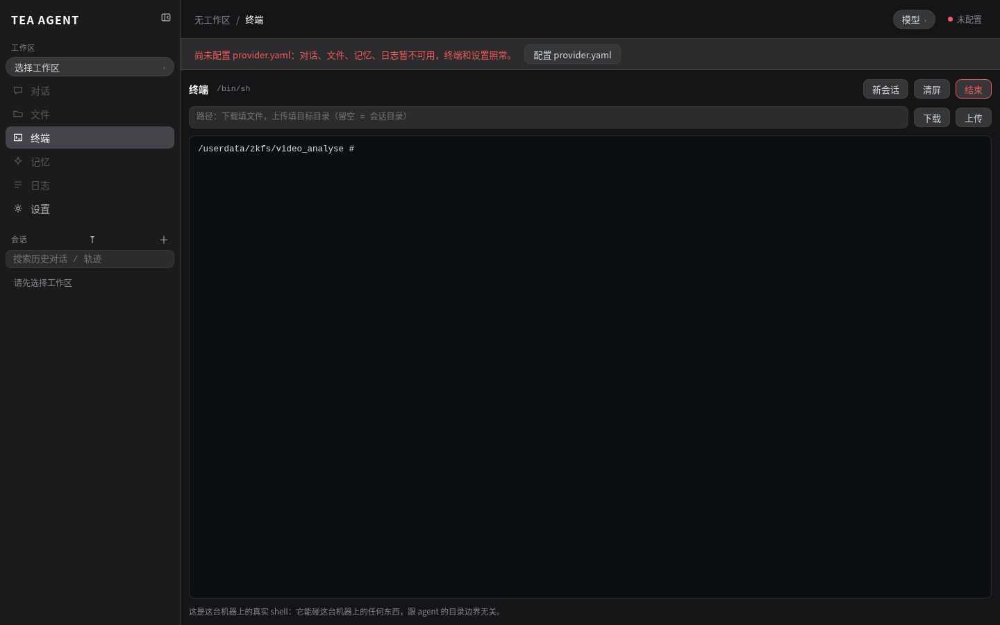

横幅的意思是：**对话、文件、记忆、日志这些要过模型的页签暂时不能用，
但终端和设置照常**（设备不会因为没 key 就变成砖头，运维该干的活仍然干得了）。

### 2.2 第 ② 步：快速设置 API key（不需要会写 yaml）

1. 左下角「**设置**」；
2. 找到「模型提供方」这一栏，点「**配置 provider.yaml…**」；
   （已经有配置、想换 key 的，点「**重置 provider…**」——同一个对话框，但标题变成「重置 provider 配置」，上面挂一条黄色警告「⚠ 会覆盖现有配置，且无法撤销」）

   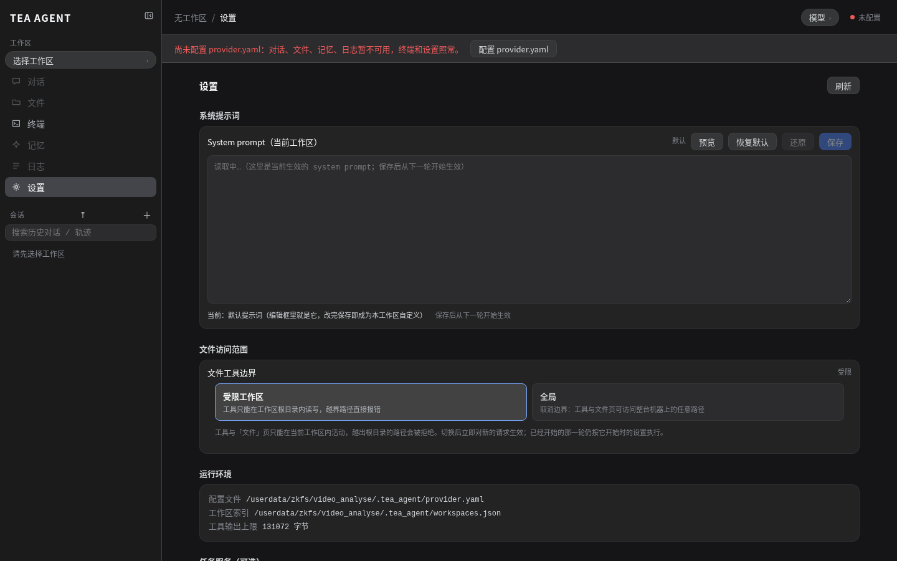

3. 弹出的对话框上半部分就是「**快捷开始：只填 API key**」——
   这是给现场同事准备的：**只需要一个 key**，服务端自己生成整份 yaml。

   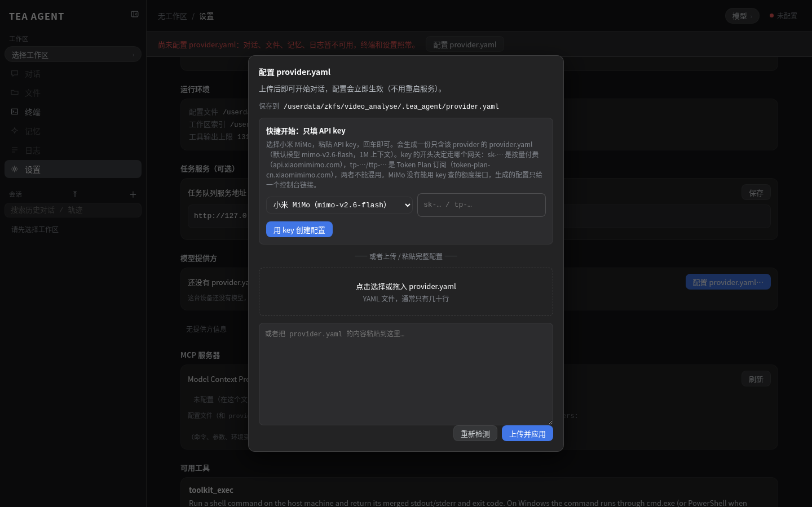

4. 下拉选「**小米 MiMo（mimo-v2.6-flash）**」，把 key 粘进输入框
   （输入框是密码框，截图里是掩码，**不会泄露**）。

   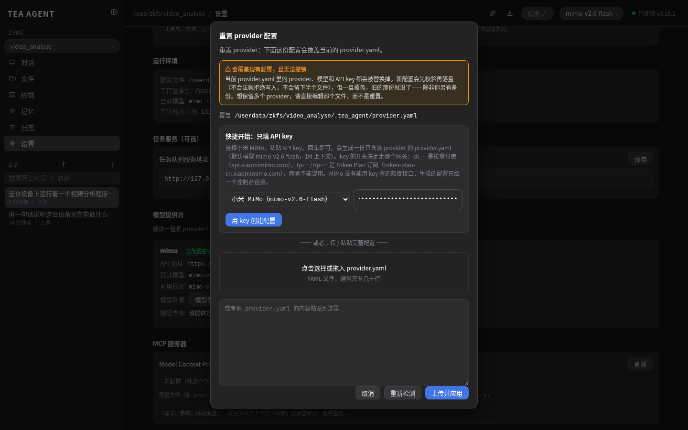

   > 这是一份包年得 key: tp-c2uwp0b2xr1crb4jw6obhzsaklcdufgd3ypd8ux444n7mmw3

5. 点「**用 key 创建配置**」。提示变成
   「已用 mimo 创建配置（mimo-v2.6-flash），正在刷新…」，然后页面自己刷新一下——
   **不用重启服务**，配置是热加载的。

   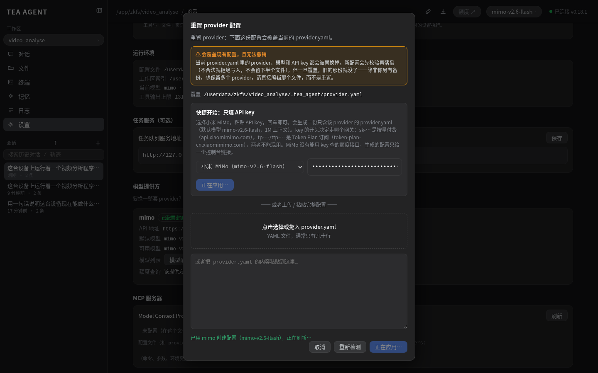

6. 右上角状态条变绿「已连接 v0.18.1」，模型小标显示 `mimo-v2.6-flash`，就绪。

<details>
<summary>它到底往磁盘里写了什么（点开看，需要手改配置时才有用）</summary>

写的是 `<tea_home>/provider.yaml`，内容大致如下（key 换成了你自己的）：

```yaml
version: 1
providers:
  mimo:
    api_url: 'https://token-plan-cn.xiaomimimo.com/v1'
    api_key: 'tp-…'
    usage_console_url: 'https://platform.xiaomimimo.com/#/console/plan-manage'
    reasoning_content: keep
    models:
      mimo-v2.6-flash:
        max_context_tokens: 1000000
        max_output_tokens: 128000
        supports_tools: true
        supports_reasoning: true
        supports_vision: true
        reasoning_effort: auto
      mimo-v2.6-pro:
        …（同上）
```

- 第一个 provider、第一个 model 就是默认值，所以「顺序」就是开关；
- `reasoning_content: keep` 表示模型思考时会把 `reasoning_content` 带回来；
- 想加第二个 provider（DeepSeek / MiniMax…），照这个格式再加一段就行，
  改完在设置页点「刷新」或调用 `POST /api/config/reload`。

</details>

> **配错了怎么办**：设置页「重置 provider…」→ 同一个快捷通道再填一次即可。
> 服务端会先校验再替换，**填坏了不会覆盖现有一份能用的配置**。

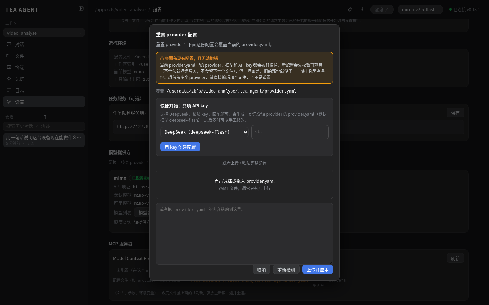

### 2.3 第 ③ 步：初始化工作区

a2 的「工作区」= 一个项目目录。工作区是 **`/userdata/zkfs/video_analyse`**
（也就是设备上跑视频分析程序的那个目录）。

1. 点左上角「**工作区**」下拉（未选择时显示「选择工作区」）；
2. 点「**＋ 添加工作区…**」；
3. 填**绝对路径**：`/userdata/zkfs/video_analyse`（名称可留空，会自动取目录名 `video_analyse`）；

   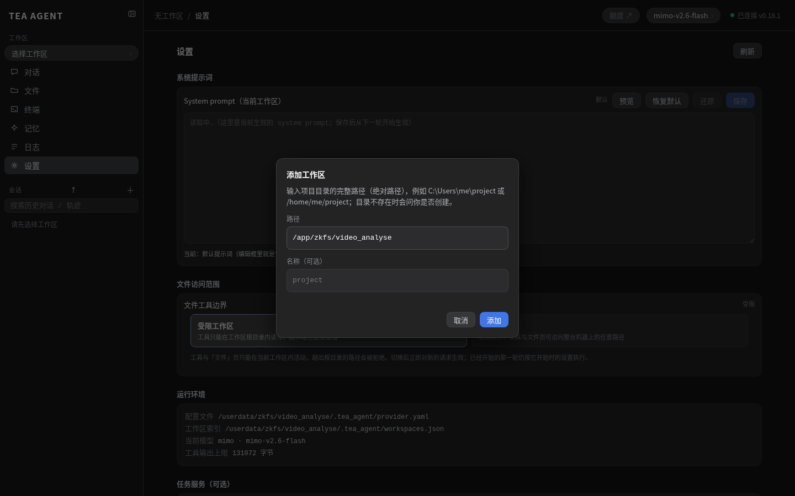

4. 点「添加」。目录不存在的话，会弹一个标题为「**目录不存在**」的确认框，
   里面写着「将创建 /userdata/zkfs/video_analyse」，点「**创建并添加**」就行，
   **不用先去终端 mkdir**。

   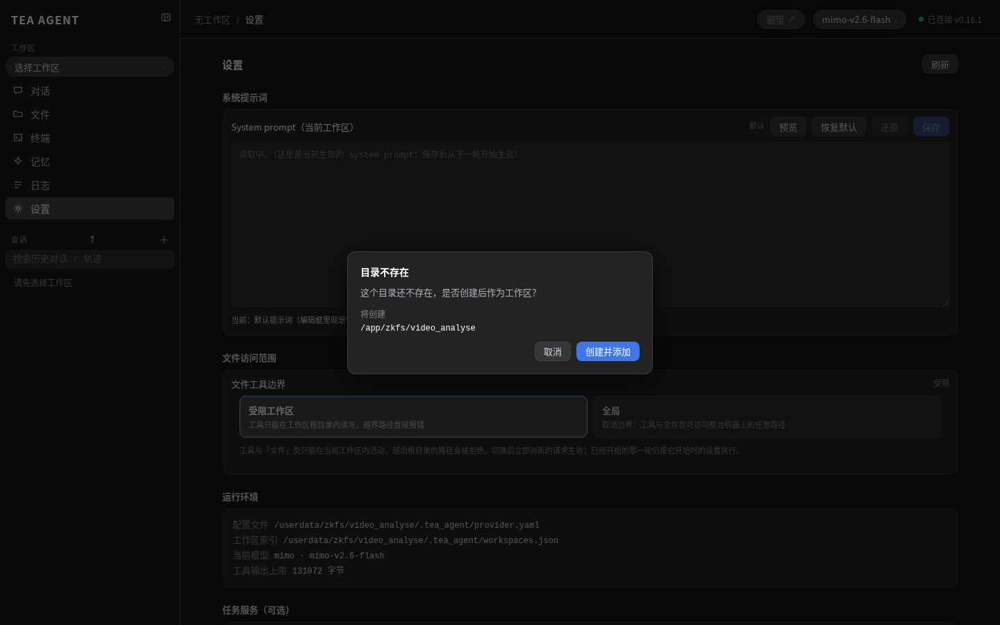

5. 成功后左侧工作区列表出现 `video_analyse`，顶部面包屑显示完整路径
   `/userdata/zkfs/video_analyse / 对话`，右下角会闪一条「已添加工作区」的提示。

   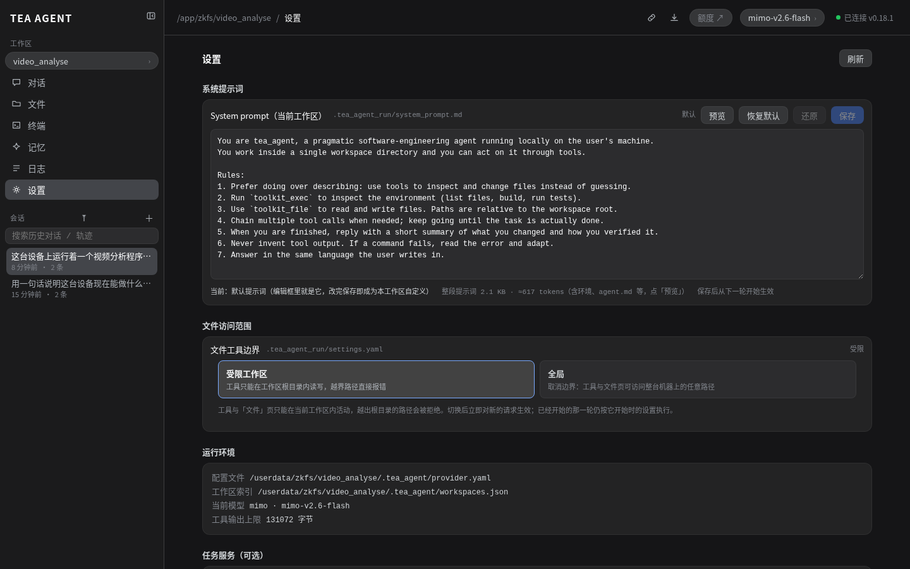

<details>
<summary>用命令行做同样的事（脚本化、批量部署时用）</summary>

```bash
# 登记并切换到默认工作区（create=true = 目录不存在就建）
curl -s -X POST http://172.16.1.46:19318/api/workspaces \
     -H 'Content-Type: application/json' \
     -d '{"path":"/userdata/zkfs/video_analyse","name":"video_analyse","create":true}'

# 看登记了哪些工作区、能不能写进去
curl -s http://172.16.1.46:19318/api/workspaces | jq '.workspaces[] | {name, path, writable, write_error}'
```

`writable:false` 表示这个目录**能读不能写**（只读挂载 / 权限不足），
这时候里面的会话都会失败——先看 `write_error` 里操作系统自己给的话。

</details>

### 2.4 验证：问一句

在「对话」页输入框里问一句，比如「这台设备上有哪些文件？」，回车。

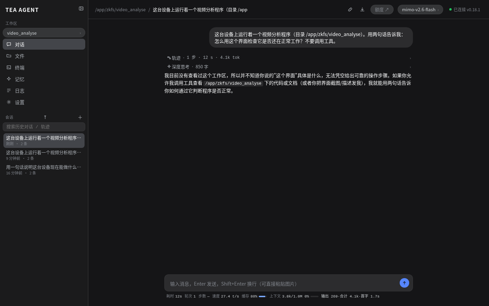

底部会显示这轮的**耗时 / 轮次 / 步数 / 速度 / 上下文占用**——售后排查时先看这排数字：
回答慢是模型慢，步数多是模型在反复调工具，轮次 > 1 说明它自己续跑了好几轮。

---

## 3. 终端怎么用

a2 的「**终端**」页签就是**这台设备自己的 shell**，浏览器直接驱动它，
**不经过模型、不烧 token**——查日志、看现场、改配置都用它，比 SSH 还快。

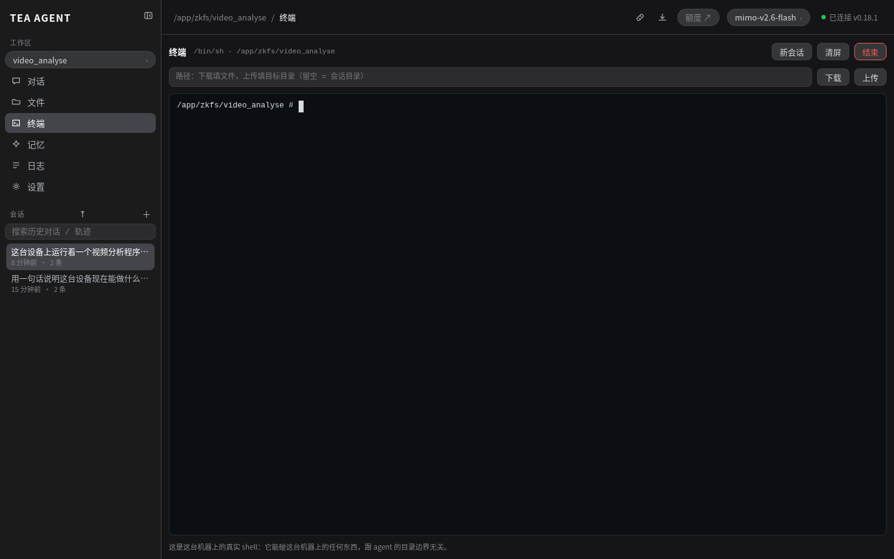

### 3.1 怎么用

| 操作 | 做法 |
| --- | --- |
| 执行命令 | 点终端画面 → 直接敲命令 → 回车 |
| 换 shell 当前目录 | 在终端里直接敲 `cd /userdata/zkfs/video_analyse`（那个「路径」框管的是上传/下载的落点，不是 cwd） |
| 传文件到设备 | 右上「**上传**」选本地文件；「路径」框填目标目录，留空 = 会话目录 |
| 取文件回自己电脑 | 先 `ls` 找到文件，再点「**下载**」（同样受「路径」框控制） |
| 关掉这个 shell | 右上「**结束**」（红色按钮） |

几个必须知道的点：

- **这是 BusyBox ash，不是 bash**：`uname`、`head -c`、`which` 这些**没有**
  （`head` 只有 `-n`，没有 `-c`；要用 `command -v` 而不是 `which`）。
  命令报「not found」多半不是设备坏了，是这个命令本来就不在。
- **终端会话最多 8 个**。浏览器关掉 ≠ 会话结束，反复开关会把设备占满，
  再开就报 `too many shell sessions are open (limit 8); close one first`，
  **终端就再也用不了**。用完点「结束」，或让会话自己超时。
- 终端里的权限 = a2 进程权限（设备上实际是 root），**它能改系统文件**。
  排查问题随便看，**改东西前先想清楚**，尤其是 `/userdata/zkfs/video_analyse` 下的
  模型和升级脚本。

### 3.2 现场最常用的三条命令

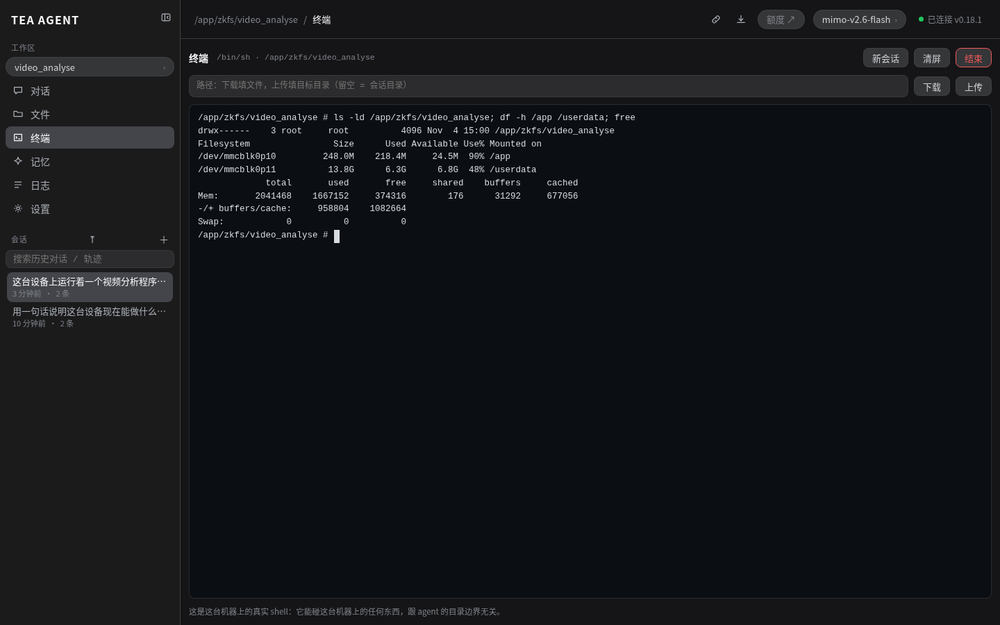

```sh
ls -ld /userdata/zkfs/video_analyse     # 工作区目录在不在
df -h /app /userdata                # 磁盘：/app 只剩 24MB 时先看这里
free                               # 内存：2GB 的机器，used 1.6GB 就要小心
```

### 3.3 自检：一条命令看清服务状态

设备上自带 `curl`，不用另开 SSH：

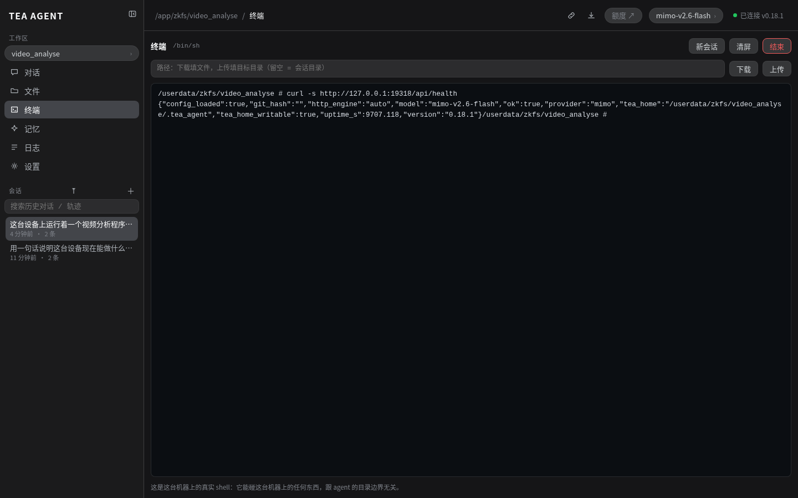

```sh
curl -s http://127.0.0.1:19318/api/health
# {"config_loaded":true,"model":"mimo-v2.6-flash","ok":true,
#  "provider":"mimo","tea_home":"/userdata/zkfs/video_analyse/.tea_agent",…}
```

关键字段：

| 字段 | 含义 |
| --- | --- |
| `ok` | 服务活着 |
| `config_loaded` | 有没有配上 provider（`false` = 还没 key，对话页不能用） |
| `provider` / `model` | 当前在用哪个 provider、哪个模型 |
| `tea_home` | 配置和索引放在哪 |
| `tea_home_writable` | 能不能写进配置目录（不能写就配不了 key） |
| `version` / `uptime_s` | 版本与运行时长 |

---

### 3.4 能做啥

一般来说可以使用大模型复制运维排错，比如这台设备得 mqtt 注册有问题，可以在对话中输入：“帮我检查这台机器得 mqtt 日志”，或者更详细的 “$HOME/shell2/system_srv/server.py 是系统服务，提供日志存储功能，通过 python shell2/common/Product.py 能获取设备得 db, log 存储目录。
好的，现在检查今天的日志，看看 mqtt 是否有问题？另外统计一下今天生成的 sdb 数目，列出启动分析，结束分析的时间”

越详细，得到的回答越准确，而且节省时间

## 4. 日常运维动作

### 4.1 文件页：看/改/传设备上的文件

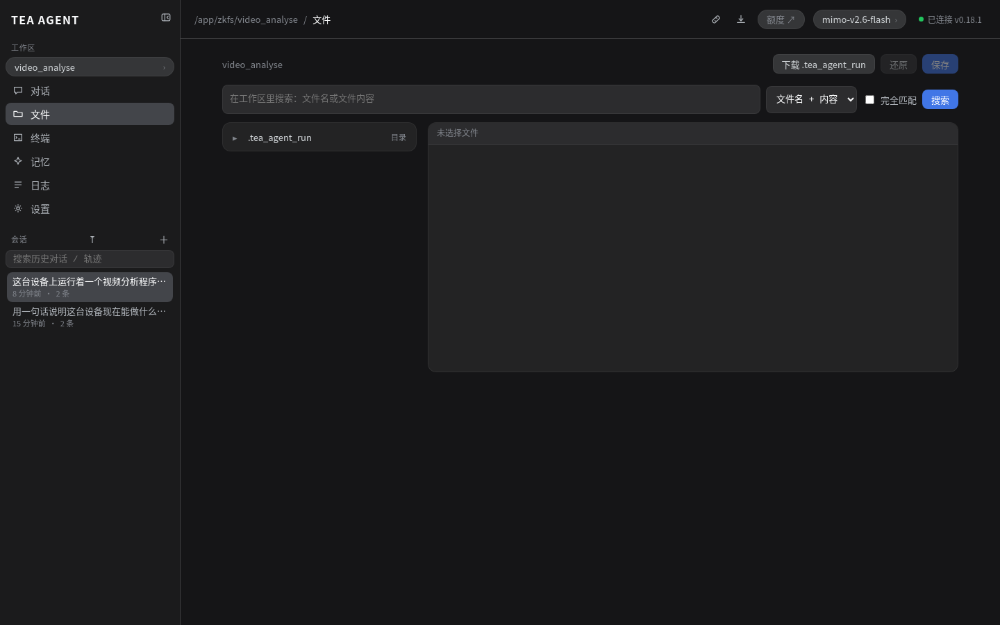

工作区目录树、在线编辑保存、下载、拖拽上传都在这一页。
**注意**：文件页受「文件访问范围」限制（设置页的「受限工作区 / 全局」），
默认只能碰当前工作区；要看整台机器，去终端。

### 4.2 日志页：a2 自己的运行日志

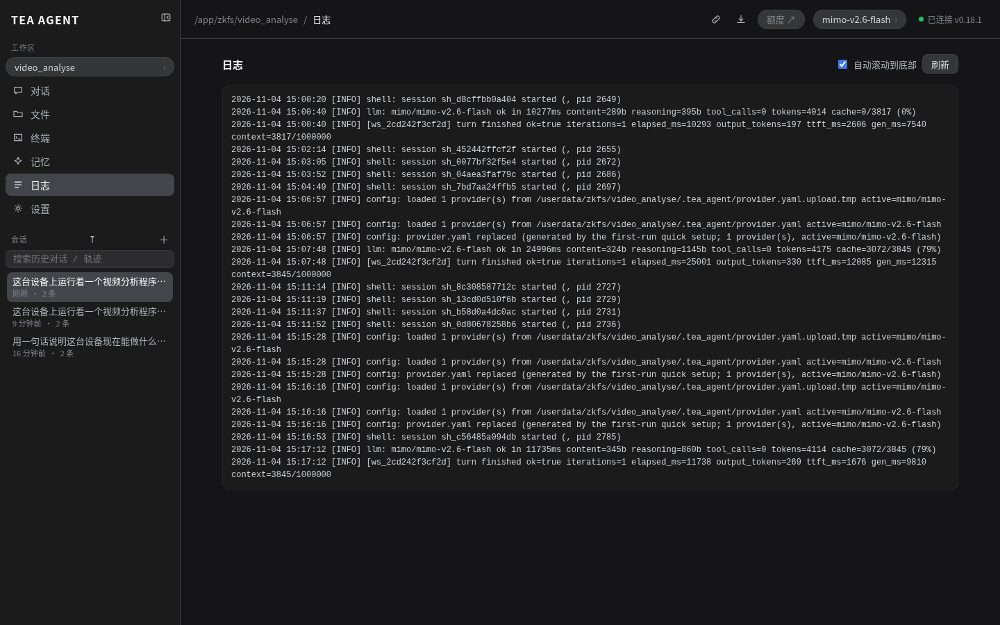

a2 的日志（不是业务程序的日志）。业务程序的日志在终端里看
`/userdata/zkfs/video_analyse/run*.log`、`log.txt`、`upgrade.log` 等。

### 4.3 记忆页：跨会话的经验

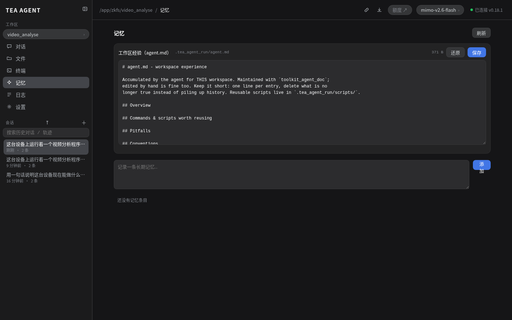

- `agent.md`：**这个工作区怎么干活**（踩过的坑、可复用脚本、约定），
  agent 自己会维护，下一轮就能用；
- 长期记忆：结构化的事实与偏好（「这个项目用 yarn 不用 npm」）。

现场排障时，把「这台设备要注意什么」写进 `agent.md`，下次换人接手也能直接用。

### 4.4 换模型

右上角模型小标（`mimo-v2.6-flash`）点开可切换；
配好的 provider 里还有 `mimo-v2.6-pro`（同规格，更聪明也更贵）。
**MiMo 没有能用 key 查的额度接口**（`/api/providers/mimo/usage` 直接返回
`usage_not_supported`），所以顶栏「额度」小标对 MiMo 来说是个**链接**：
点开直接跳小米控制台看用量（它**不发任何请求**），不会报数字——
这是正常的，不是故障。设置页的 provider 卡片里也有一个「打开控制台」按钮。

---

## 5. 排错表

| 现象 | 原因 | 怎么办 |
| --- | --- | --- |
| 红色横幅「未配置 provider.yaml」 | 没 key | 设置页「配置 provider.yaml…」走快捷通道 |
| 顶栏「未配置」，对话页发不出消息 | 同上 | 同上；配好后是热加载，**不用重启** |
| `401` / 模型报错 | key 形状与网关不匹配 | `sk-` 走 `api.xiaomimimo.com`，`tp-` 走 `token-plan-cn.xiaomimimo.com`；用「重置 provider…」重来 |
| `too many shell sessions are open (limit 8)` | 终端会话开太多没关 | 终端页点「结束」关掉多余的；实在不行等会话超时 |
| 终端报 `xxx: not found` | BusyBox 没有这个命令 | 换等价写法（`command -v` 代替 `which`，`head -n` 代替 `head -c`） |
| 工作区列表里 `writable:false` | 目录只读 / 权限不足 | 看 `write_error` 里的系统提示；换目录或修权限 |
| `/api/exec` 返回 404 | 设备没开机群通道 | 需要重启服务并加 `--api-token`（不建议现场临时加） |
| 回答慢、步数多 | 模型在反复调工具 | 看底部「步数」；提示词里把范围说窄一点 |
| 磁盘告警 | `/app` 只剩 24MB | `df -h /app /userdata`；清理 `/userdata/zkfs/video_analyse` 下的日志/临时文件，**别删 `.onnx` 模型和升级脚本** |
| 页面显示「无法连接到本地服务」 | 服务没起 | 终端 `curl -s http://127.0.0.1:19318/api/health`；无响应就是进程挂了，需要重启 a2 |

---

## 6. 安全须知

1. **key 别外传**：key 存在 `<tea_home>/provider.yaml`（权限 0600），
   截图里输入框是掩码，但如果你把终端里 `cat provider.yaml` 的输出发到群里，
   key 就泄露了——需要贴配置时先把 key 段删掉。
2. **终端是 root shell**：它能改系统文件、能停业务进程。
   排查随便看，**改动前先备份**（`cp x x.bak`）。
3. **别点「销毁…」**：设置页底部那个按钮会删掉 tea home 和所有工作区的
   `.tea_agent_run/`（会话、日志、记忆全没），**不可逆**。
   它会先弹预览确认页，看到路径列表一定要看清楚再点。
4. **机器对机器的通道没开**：这是好事。别为了图方便在生产设备上随手加 `--api-token`，
   加了等于把这台机器的 shell 暴露给能连到它的人。
5. **换 key 用「重置 provider…」**：不要直接 `rm provider.yaml`——
   内存里的配置还在，界面显示的和磁盘上的会对不上。

---

## 7. 附录 A：完整接口速查（这台设备上实测可用）

| 方法 | 路径 | 用途 |
| --- | --- | --- |
| GET | `/api/health` | 探活、版本、provider/model、tea_home |
| GET | `/api/status` | 设备快照（名称/版本/CPU/内存/磁盘/工作区数） |
| GET | `/api/workspaces` | 工作区索引（含 `writable`/`write_error`） |
| POST | `/api/workspaces` | 登记工作区（`{"path","name","create"}`） |
| GET | `/api/workspaces/{id}/tree?path=` | 列目录 |
| GET/PUT | `/api/workspaces/{id}/file` | 读 / 写文件 |
| GET | `/api/workspaces/{id}/logs?tail=300` | a2 运行日志尾部 |
| GET/POST | `/api/workspaces/{id}/sessions` | 会话列表 / 新建 |
| POST | `/api/chat` | 对话（SSE 流式） |
| POST | `/api/chat/stop` | 中断当前轮次（必须带 `session_id`） |
| GET | `/api/tools` | 设备上可用的工具清单（当前 13 个） |
| GET | `/api/providers` | provider 清单与能力标记（**不含 key**） |
| POST | `/api/config/quickstart` | 快捷配置：只给 provider + key |
| POST | `/api/config` | 上传完整 `provider.yaml`（先校验再替换） |
| POST | `/api/config/reload` | 重新读磁盘上的 yaml 并热加载 |
| GET | `/api/shell` | 终端能力（`/bin/sh`，pty 后端） |
| GET | `/api/shell/sessions` | 终端会话列表（**上限 8**） |
| POST | `/api/shell/session` | 新建终端会话 |
| POST | `/api/shell/session/{id}/input` | 往终端写命令 |
| DELETE | `/api/shell/session/{id}` | 关掉终端会话 |
| GET | `/api/turns` | 正在跑的轮次 |
| GET | `/api/mcp/servers` | MCP 服务器状态（设备上未配置） |

设备上**不存在**的路由（因为没加 `--api-token`）：
`/api/exec`、`/api/peer/*` → 404。

---

## 8. 附录 B：这些截图是怎么来的（可复现）

截图脚本在仓库里，跑一次就能重拍：

### 用 Playwright 批量巡检多台设备（给做工具的同事）

界面能点到的，接口都能做；想批量巡检就直接上 Playwright：

```js
// 巡检一台设备：探活 → 看工作区 → 看模型
const BASE = 'http://172.16.1.46:19318';
const health = await (await fetch(`${BASE}/api/health`)).json();
const ws     = await (await fetch(`${BASE}/api/workspaces`)).json();
console.log(health.version, health.provider, health.model,
            ws.workspaces.map((w) => `${w.name}:${w.writable}`).join(', '));

// 要点界面（比如走一遍「配置 provider.yaml…」对话框）：
const { chromium } = await import('playwright-core');
const browser = await chromium.launch({
  executablePath: `${process.env.HOME}/.cache/ms-playwright/chromium-1223/chrome-linux64/chrome`,
  headless: true, args: ['--no-sandbox'] });
const page = await (await browser.newContext()).newPage();
await page.goto(BASE + '/');
await page.click('button[data-view="settings"]');
await page.click('#setup-config');            // 打开「配置 provider.yaml…」
await page.selectOption('#setup-provider', 'mimo');
await page.fill('#setup-key', process.env.A2_MIMO_KEY);
await page.click('#setup-quick-apply');       // 用 key 创建配置
await page.waitForSelector('#setup-ok:not(.hidden)');
```

两个必须记住的坑：**终端里打字要慢**（≥50ms/字符，否则掉字符）；
**终端会话最多 8 个**，脚本跑完要 `DELETE /api/shell/session/{id}` 清干净。

```bash
# 拍「未配置 → 配 key → 建工作区 → 终端 → 对话 → 日志」全流程
node .tea_agent_run/scripts/a2_device_shots.mjs

# 补拍「已配置」状态（换 key、干净的终端命令、curl 自检、完整回答、记忆页）
node .tea_agent_run/scripts/a2_device_shots2.mjs
node .tea_agent_run/scripts/a2_device_shots3.mjs

# 只收集设备事实（CPU/内存/磁盘/命令清单）
node .tea_agent_run/scripts/a2_device_probe.mjs
```

要点：

- Playwright 用 `.tea_agent_run/node_modules/playwright-core`（1.49.1）+
  本机 `~/.cache/ms-playwright/chromium-1223`；
- **终端里打字要慢**（≥50ms/字符）：浏览器终端是逐字节喂给远端 shell 的，
  打得快会掉字符（`uname -a` 变成 `em`），截图会看着像设备故障；
- **跑完必须关终端会话**（`DELETE /api/shell/session/{id}`），
  否则占满 8 个上限，后续脚本连终端都开不了；
- 每张图都写了一条「现场状态」到 `docs/images/a2_device/manifest.json`，
  方便核对这张图到底是哪一步；
- 图注是**核对过的**：脚本对每张图断言页面状态（标题、面包屑、列表内容…），
  断言不过就不落盘；剩下几张状态类的图，是**让设备自己的 a2 用
  `toolkit_load_image` 看图**回答「这是哪一页 / 对话框标题是什么 / 有哪些按钮」，
  按它的回答改的图注（设备上的模型支持 vision，这条链路本身就是通的）。

---

## 9. 附录 C：给售后同事的一句话版本

> 浏览器开 `http://172.16.1.46:19318` →
> **设置 → 配置 provider.yaml… → 选「小米 MiMo」→ 粘 `tp-` key → 用 key 创建配置** →
> **左上工作区 → ＋ 添加工作区… → `/userdata/zkfs/video_analyse` → 创建** →
> 回「对话」页问一句，绿色「已连接」就说明通了。
> 要看现场就用左边的「**终端**」（设备自己的 shell，用完点「结束」）。
