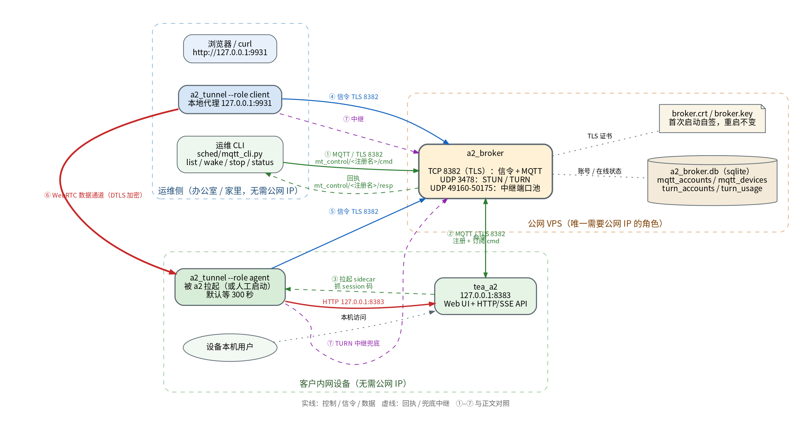
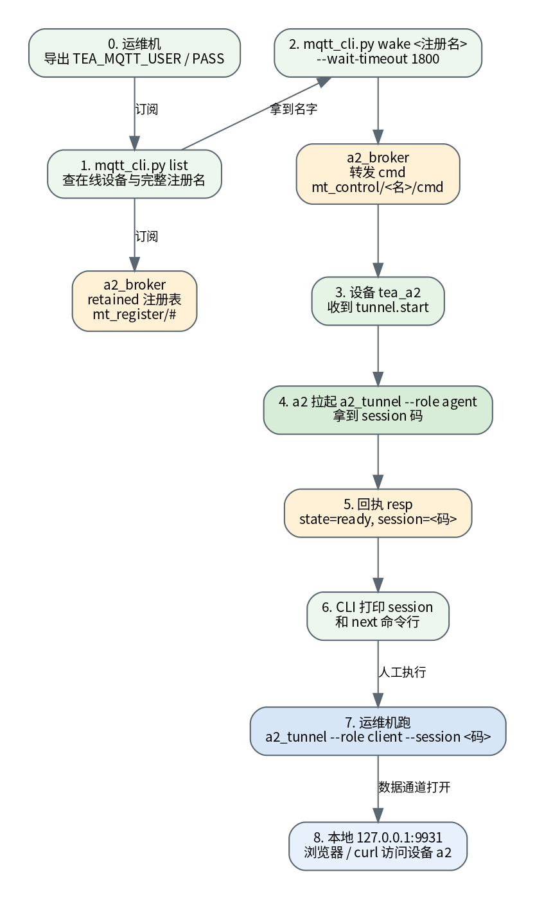

# 内网穿透运维手册：a2_broker + tea_a2 + a2_tunnel

> **适用版本**：tea_a2 / a2_tunnel / a2_broker **1.8.2**（协议向后兼容 1.8.x）。
> **读者**：客户现场的运维/实施同事，以及需要在外面访问内网设备的我们自己人。
> **目标**：读完这一篇，你能独立完成「公网 broker → 内网设备 → 运维机」的部署、
> 日常使用、排错和升级；知道每一步在做什么、失败了先看哪里。

> ⚠️ 这篇是**操作手册**，不是设计文档。想了解为什么这么设计，见
> [`tunnel.md`](tunnel.md)；只想查某个参数，见每章后面的参数表。

---

## 目录

| 想做什么 | 去哪一节 |
| --- | --- |
| 先搞懂三个程序分别是什么 | [1. 三个程序与整体结构](#1-三个程序与整体结构) |
| 看整体网络图、端口图 | [1.4 整体网络结构图](#14-整体网络结构图) |
| **三分钟跑通一遍** | [2. 三分钟部署实例](#2-三分钟部署实例) |
| 装设备上的 a2、配 MQTT、配模型 | [3. tea_a2 使用详解](#3-tea_a2-使用详解) |
| 在设备/运维机上起隧道、远程桌面 | [4. a2_tunnel 使用详解](#4-a2_tunnel-使用详解) |
| 装公网 broker、开端口、管账号 | [5. a2_broker 使用详解](#5-a2_broker-使用详解) |
| 已经有 ssh 了，还要不要用隧道 | [1.6 对比：ssh -L 还是 a2_tunnel](#16-对比ssh--l-还是-a2_tunnel) |
| 出问题了按症状查 | [6. 端到端场景与排错](#6-端到端场景与排错) |
| 查端口 / 路径 / 命令 | [7. 附录：速查表](#7-附录速查表) |

**先记住三句话**：

1. **tea_a2 是被访问的那台机器上的 agent**，默认只监听 `127.0.0.1:8383`，它自己不知道隧道存在。
2. **a2_tunnel 是隧道两端的小进程**：设备上跑 `agent`，运维机上跑 `client`，中间靠 session 码配对。
3. **a2_broker 是公网上的会合点**：STUN + TURN + 信令（+ 可选 MQTT 控制通道），是唯一需要公网 IP 的角色。

> 下文的 `a2` 就是 `tea_a2`（发布包里的文件名）；现场常把它软链成 `~/bin/a2`。
> 命令里写 `a2` 的地方，没建软链就换成 `tea_a2`。

---

## 1. 三个程序与整体结构

### 1.1 tea_a2（a2 本体）

一句话：**一个带 Web UI、HTTP/SSE API、工作区和工具的单二进制 LLM agent**。

| 项目 | 说明 |
| --- | --- |
| 二进制 | 发布包里叫 `linux_x86_64/tea_a2`（Windows 是 `tea_a2.exe`）；现场常改名/软链成 `a2` |
| 默认监听 | `127.0.0.1:8383`，**只允许本机访问** |
| Web UI | `http://127.0.0.1:8383/`（界面编译进二进制，不需要额外的 web 目录） |
| HTTP API | `/api/health`、`/api/status`、`/api/workspaces`、`/api/chat`、`/api/turns/...` 等 |
| 配置 | `~/.tea_agent/provider.yaml`（模型 provider）；`~/.tea_agent/` 是它的主目录 |
| 工作区 | `--workspace <path>` 注册；默认可以访问工作区之外的哪些路径由参数决定 |
| MQTT 控制通道 | 可选：`--mqtt ...` 让设备能被运维「召唤」出一条隧道 |
| 认证 | **没有登录认证**。默认绑 127.0.0.1 就是它的安全边界 |

它在隧道里的角色是**被访问的服务**：

```
浏览器/curl ──HTTP──▶ a2_tunnel agent ──HTTP──▶ 127.0.0.1:8383 (tea_a2)
```

所以：

- **a2 不需要公网 IP，也不需要知道 broker 的存在**（除非开了 MQTT 控制通道）；
- 隧道断了、broker 挂了，a2 照常在本机工作；
- 通过隧道访问时，你用的是**设备本机的 a2**，不是运维机上的 a2。

### 1.2 a2_tunnel（隧道侧载 / sidecar）

一句话：**把一头收到的字节原样送到另一头的单二进制小进程**。它不是 a2 的一部分，
a2 停了它也可以单独跑；它挂了 a2 也不受影响。

它有四个角色：

| 角色 | 跑在哪 | 干什么 |
| --- | --- | --- |
| `--role agent` | **内网设备上**（a2 旁边） | 在 broker 的房间里等外面来连；把连接转给本机 a2 |
| `--role client` | **运维机上** | 连进房间，在本机开一个代理端口（默认 `127.0.0.1:9931`） |
| `--role desktop` | **内网设备上** | agent + 抓屏编码，把画面推给外面 |
| `--role control` | **运维机上** | client + 解码画面给浏览器（默认看 `127.0.0.1:9932`） |

普通运维只需要 `agent` / `client` 两个角色。远程桌面是可选能力，见 [4.4](#44-远程桌面desktop--control)。

**一次隧道只有一个东西需要在两边传递：session 码。**

```
设备：a2_tunnel --role agent
      → sidecar: ready. ... session 43910a0ab1600dc462b072114fe90132
运维：a2_tunnel --role client --session 43910a0ab1600dc462b072114fe90132
```

session 码同时派生**房间名**和**房间令牌**；谁拿到码谁就能进这个房间。
侧载每次启动都会生成新码，旧码随即失效。

**数据通道有两条**（靠标签分开，互不干扰）：

| 通道 | 标签 | 内容 |
| --- | --- | --- |
| a2 | `a2` | a2 的 HTTP / SSE 字节（普通隧道的全部内容） |
| screen | `screen` | H.264 画面 + 鼠标键盘（只有 desktop/control 角色） |

**直连还是中继**：

- 侧载先尝试 UDP 打洞（STUN），能直连就直连；
- 打不通就自动走 broker 的 **TURN 中继**；
- 客户现场是家用宽带/对称 NAT 时，**中继是常态**，不是故障。日志里会明确写
  `direct (no relay)` 或 `through the broker`。

### 1.3 a2_broker（公网会合点）

一句话：**一个进程同时做 STUN、TURN、TLS 信令，以及可选的 MQTT 控制通道**。
它只需要一个二进制和一个可写的目录，不需要 nginx、不需要 Python、不需要数据库服务
（账号簿是内嵌的 sqlite 文件）。

| 职责 | 端口 | 说明 |
| --- | --- | --- |
| STUN | UDP 3478 | 让两侧发现自己的公网映射地址，尝试打洞 |
| TURN 中继 | UDP 3478 + UDP 49160-50175 | 打洞失败时转发 DTLS 密文（**主路径**） |
| 信令 | TCP 8382（TLS） | 两侧交换 SDP/ICE 候选、校验房间令牌 |
| MQTT 控制通道 | 与信令共用 TCP 8382 | `--mqtt` 打开；TLS 后按首字节区分 MQTT / 信令 |
| 账号与用量 | `a2_broker.db`（sqlite） | TURN 账号、MQTT 账号、设备在线表、中继用量 |

**信任模型**：

- **房间令牌**是进房间的钥匙（藏在 session 码里），不是证书；
- broker 的证书是**首次启动自签**的，重启不变；客户端**不验证书链**，
  `--tls-pin` 只是「看着」，对不上会提示但不断隧道；
- MQTT 的账号是**口令**，TLS 只负责加密；
- TURN 账号保护的是中继带宽，和 MQTT 账号是两张表，**不能互相登录**。

broker 是唯一站在公网上的组件，所以它也是唯一需要认真做防火墙、容量和备份的组件。
现网默认的 broker 是 **103.232.92.54:8382**（`a2_tunnel` 不写 `--broker` 时就用它）；
自己部署时换成你的 VPS 地址即可。

### 1.4 整体网络结构图



> 图的 dot 源文件：[`images/tunnel/ops_tunnel_topology.dot`](images/tunnel/ops_tunnel_topology.dot)。
> 重新渲染：`cd docs/images/tunnel && dot -Tpng -Gdpi=150 ops_tunnel_topology.dot -o ops_tunnel_topology.png`

按编号读：

| 编号 | 谁到谁 | 协议/端口 | 作用 |
| --- | --- | --- | --- |
| ① | 运维 CLI → broker | MQTT over TLS，TCP 8382 | `list` / `wake` / `stop` / `status`，发到 `mt_control/<注册名>/cmd` |
| ② | 设备 a2 → broker | MQTT over TLS，TCP 8382 | 注册（retained）+ 订阅自己的 cmd；断开时用 will 标 offline |
| ③ | a2 → 本机 agent | 进程拉起 | 收到 `tunnel.start` 后启动 `a2_tunnel --role agent`，从 stdout 抓 session 码 |
| ④ | 运维 client → broker | 信令 over TLS，TCP 8382 | 用 session 码进房间，交换 ICE/SDP |
| ⑤ | 设备 agent → broker | 信令 over TLS，TCP 8382 | 同一个房间的另一侧 |
| ⑥ | 运维 client ↔ 设备 agent | WebRTC 数据通道（DTLS） | HTTP/SSE 字节；desktop 时还有 screen 通道 |
| ⑦ | 两侧 → broker | TURN over UDP 3478 / 49160+ | 打洞失败时的中继路径 |

**三条容易混淆的边界**：

- **9931 在运维机上**，不是设备上；它是 client 侧开的本地代理口，只绑 `127.0.0.1`。
- **8382 是 broker 的公网口**，不是 a2 的 Web 端口；a2 的 8383 永远只在设备本机。
- **MQTT 和信令共用一个端口**，但仍是两个协议；不要以为开了 MQTT 就要多开一个端口。

### 1.5 三种接入姿势

| 姿势 | 设备需要什么 | 谁发起 | session 码怎么到运维手上 | 适合 |
| --- | --- | --- | --- | --- |
| **A. 现场起 agent** | 人工在设备上跑 `a2_tunnel --role agent` | 设备侧 | 现场人员把命令行念/发给运维 | 临时排障、没有 MQTT 的环境 |
| **B. MQTT 召唤**（推荐） | a2 常驻并带 `--mqtt ...` | 运维侧 | `mqtt_cli.py wake` 自动打印 | 设备无人值守、需要随时召唤 |
| **C. 微信 `/tunnel`** | 设备上跑着微信 bot | 运维/用户发微信 | bot 回复一条命令 | 人不在电脑前、只有手机 |

三种姿势的**隧道本身完全一样**，区别只在「谁把 agent 拉起来、码怎么传」。

### 1.6 对比：ssh -L 还是 a2_tunnel

> 运维同事都会 `ssh -L`，那就得说清楚：**这俩不是替代关系，而是两种不同的「怎么连到设备」**。
> 先看结论，再看细节。

**一句话结论**

- **设备上能 ssh 进去（能开 22 端口、或者有堡垒机/VPN）** → 用 `ssh -L`。零部署成本、身份可审计，是首选。
- **设备在客户内网、不能开入站端口、没有 sshd、或者要「无人值守地随时召唤」** → 用 `a2_tunnel`。它只要求设备**能主动 outbound**。

#### 1.6.1 两条路走的是同一段路

`a2_tunnel` 的 client 侧在本机开的那个 `127.0.0.1:9931`，**就是一个字节透明的 TCP 转发**
（一条数据通道上按连接 id 复用多路 TCP 流），和 `ssh -L` 的本地端口是同一个角色：

```bash
# ssh -L：本地 9931 → 设备的 127.0.0.1:8383
ssh -L 9931:127.0.0.1:8383 user@device
# a2_tunnel：本地 9931 → 设备的 127.0.0.1:8383（中间隔着 broker/ICE）
a2_tunnel --role client --session <码>
```

所以**用法完全一样**：浏览器开 `http://127.0.0.1:9931/`、`curl http://127.0.0.1:9931/api/health`、
在运维机 a2 的 `peers:` 里写 `url: http://127.0.0.1:9931`。
**差别全在「怎么把这条连接送到设备」和「谁有资格用」。**

#### 1.6.2 逐项对比

| 维度 | `ssh -L` | `a2_tunnel` |
| --- | --- | --- |
| 设备侧要装什么 | **sshd**（很多嵌入式设备、Windows 工控机没有） | 两个二进制（`tea_a2` + `a2_tunnel`），随包发布 |
| 网络方向 | 需要**能连到设备的 22**（直连 / 堡垒机 / VPN） | 只需要设备**主动 outbound** 到 broker（8382/TCP、3478/UDP）；**客户网络不暴露任何入站端口** |
| 认证 | **账号 + 密钥**：有身份、有权限、每次登录有审计（sshd 日志） | **session 码即钥匙**：谁拿到码谁能进，没有用户身份 |
| 加密 | SSH 端到端 | 数据通道 DTLS 端到端（broker 只转发密文）；信令走 TLS；房间令牌是唯一的门 |
| 中间人风险 | 有（host key 校验可发现） | broker 证书自签、客户端不验链（`--tls-pin` 只提示不拦）；口令走的是同一条链路 |
| 断线恢复 | 连接一断就没了（要 `autossh` / `ServerAliveInterval` / systemd 拉起） | **两侧自动重连并重新协商**，日志里能看到 `renegotiating` |
| 延迟与带宽 | 运维机 → 设备直连（通常经 VPN/堡垒机），路径最短 | 打洞成功时与 ssh 相当；**打洞失败就走 TURN 中继**：多一跳 VPS，延迟变高、占用 VPS 出口带宽 |
| 支持的协议 | 任意 TCP（scp/rsync/数据库/自定义端口都能带） | 任意 TCP（同样是字节透明的流），**不支持 UDP** |
| 多人使用 | 每人一个账号/密钥，权限分明 | 一个 session 码共享给多人 = 权限共享，**不建议** |
| 部署成本 | 客户端自带 ssh，零成本 | 设备装 2 个二进制 + 一台公网 broker +（可选）MQTT 账号 |
| 现场无人时 | 叫不到人（要有人 ssh 或给跳板） | `mqtt_cli.py wake` 远程召唤，**不需要现场配合** |
| 远程桌面 | 另配 ToDesk/RustDesk/VNC | `--role desktop/control` 直接带画面与键鼠 |

#### 1.6.3 怎么选（决策表）

| 现场情况 | 选哪个 | 理由 |
| --- | --- | --- |
| 设备有 sshd，运维能直接 ssh | **ssh -L** | 最省事、身份清楚、路径最短 |
| 设备没有 sshd（嵌入式/工控机/客户定制系统） | **a2_tunnel** | 不依赖 sshd |
| 客户不允许在设备上开入站端口 | **a2_tunnel** | 只出站，不暴露 22 |
| 设备在多层 NAT 后面，没有公网入口也没有 VPN | **a2_tunnel** | 靠 STUN 打洞 + TURN 中继 |
| 客户已有堡垒机 / VPN / 零信任接入 | **ssh -L**（经堡垒机） | 复用现有合规通道，别再开一条新链路 |
| 设备无人值守，随时可能要连进去 | **a2_tunnel**（MQTT 召唤） | 不需要现场配合 |
| 要看设备屏幕、动鼠标 | **a2_tunnel**（desktop/control） | 隧道自带 screen 通道 |
| 客户审计要求「谁在什么时候连了哪台设备」 | **ssh -L** | a2_tunnel 只有一把共享的码 |

> 经验法则：**先把 ssh -L 当默认**。只有当 ssh 这条路走不通（没 sshd / 开不了端口 / 到不了），
> 或者需要「远程召唤、无人值守」时，再上 a2_tunnel。两者也可以并存（见下）。

#### 1.6.4 两者混用

**① broker 是内网/私有地址时，用 ssh -L 把 broker 送出来**：

```bash
# 运维机：先 ssh 到 VPS，把 broker 的 8382 拉到本地
ssh -N -L 18382:broker.internal:8382 vps
a2_tunnel --role client --session <码> --broker 127.0.0.1:18382

# 设备侧同理：设备自己 outbound 一条 ssh 隧道到 broker
ssh -N -L 18382:broker.internal:8382 vps
a2_tunnel --role agent --broker 127.0.0.1:18382
```

**② 在 a2_tunnel 隧道里跑 ssh**（隧道是字节透明的 TCP，所以 ssh 协议能直接穿过去）：

```bash
# 设备侧把 22 带出来
a2_tunnel --role agent --target 127.0.0.1:22
# 运维机：照常 ssh，只是主机和端口换成本地的
ssh -p 9931 user@127.0.0.1
```

**③ 想让一台机器同时用两种方式**：ssh 走公司堡垒机（合规），a2_tunnel 走隧道做远程桌面，
互不干扰——它们只是各自占一个本地端口（`ssh -L 9931` 与 `a2_tunnel --port 9932`）。

#### 1.6.5 什么时候**不要**用 a2_tunnel

- 客户有等保/审计要求，要**逐用户身份**追溯 → 用 ssh（a2_tunnel 的码是「谁拿都能用」）；
- 只是临时看一眼、且 ssh 能通 → 一条 `ssh -L` 就行，别为一个端口起一套 broker；
- 要传大文件/跑 rsync 批处理 → 直接 `scp/rsync over ssh`，别让隧道中继去扛带宽
  （中继流量要算 VPS 出口的）。

---

## 2. 三分钟部署实例

> 这一节是**最短路径**：假设你已经有一台能 SSH 的公网 VPS，并且发布包已经解压。
> 真实客户现场第一次部署，建议先照这一节跑通，再按第 3/4/5 章做服务化。

### 2.1 场景与地址

| 角色 | 机器 | 地址 | 跑什么 |
| --- | --- | --- | --- |
| 公网 | VPS | `203.0.113.10` | `a2_broker` |
| 内网 | 客户设备 | `192.168.1.50` | `tea_a2` + `a2_tunnel` |
| 运维 | 你的笔记本 | 任意 | `a2_tunnel` + `mqtt_cli.py` |

> 下面把发布包解压后的平台目录记作 `PKG/`（例如 `tea_a2-1.8.2/linux_x86_64`）。
> 三个二进制必须**放在同一目录**（a2 会从自己旁边找 `a2_tunnel`）。

### 2.2 第 0 分钟：broker 起来并建账号

VPS 上（第一次）：

```bash
mkdir -p ~/bin ~/.tea_agent/tunnel ~/.tea_agent/logs
install -m 755 PKG/a2_broker ~/bin/a2_broker
cd ~/.tea_agent/tunnel
~/bin/a2_broker --mqtt --cert-name 203.0.113.10
```

看到这几行就算起来了：

```
broker: STUN+TURN on udp/3478 (realm a2, relay 49160-50175, 1016 ports)
broker: mqtt on tcp/8382 (shared with signalling, accounts in mqtt_accounts)
broker: capacity: 256 peer pairs (512 allocations max, shared by all TURN accounts)
broker: signalling on tcp/8382 (TLS, bound to 0.0.0.0)
broker: certificate fingerprint (sha256): ...
```

另开一个终端，建两个账号（**只做一次**）：

```bash
sqlite3 ~/.tea_agent/tunnel/a2_broker.db <<'SQL'
-- 设备账号：可被多台设备共用；权限由设备自己的注册名决定
INSERT INTO mqtt_accounts(user, pass, role, enabled)
VALUES ('plant-device', '<设备口令>', 'device', 1);

-- 运维账号：可以列目录、给任何设备下命令、读回执
INSERT INTO mqtt_accounts(user, pass, role, enabled)
VALUES ('ops', '<运维口令>', 'operator', 1);
SQL
```

> **改库即生效，不用重启 broker**（每次 CONNECT 都查库）。
> 口令是明文存的，所以 `a2_broker.db` 要 `chmod 600`。
>
> TURN 账号（`turn_accounts`）第一次启动时是内置的那一对，只保护中继带宽。
> 正式环境建议改掉：见 [5.4.3](#543-turn-账号)（改完要重启 broker）。

防火墙/安全组要放行：

```bash
# 机器内防火墙
sudo ufw allow 8382/tcp
sudo ufw allow 3478/udp
sudo ufw allow 49160:50175/udp
# 云厂商安全组同样要放行这三条（两层缺一不可）
```

先在前台验证（验证完 `Ctrl-C`，再交给 systemd）；长期跑用 systemd。注意**单元里的 `ExecStart` 必须和二进制实际位置一致**，
并且要带 `--mqtt`（仓库模板 `scripts/a2_broker.service` 默认把二进制放在
`~/.tea_agent/tunnel/` 且没带 `--mqtt`，按本手册的 `~/bin` 布局要改）：

```ini
# ~/.config/systemd/user/a2_broker.service
[Unit]
Description=tea_a2 tunnel broker (STUN + TURN + signalling + MQTT)
After=network-online.target
Wants=network-online.target

[Service]
Type=exec
ExecStart=%h/bin/a2_broker --mqtt --cert-name 203.0.113.10 \
  --stun-port 3478 --signal-port 8382 --signal-bind 0.0.0.0 \
  --realm a2 --max-peer-pair 256 --relay-begin 49160 --relay-end 50175
WorkingDirectory=%h/.tea_agent/tunnel
Environment=HOME=%h
Restart=always
RestartSec=3s
LimitNOFILE=2048
TasksMax=2048
StandardOutput=append:%h/.tea_agent/logs/a2_broker.log
StandardError=append:%h/.tea_agent/logs/a2_broker.log

[Install]
WantedBy=default.target
```

```bash
systemctl --user daemon-reload
systemctl --user enable --now a2_broker
systemctl --user status a2_broker
```

### 2.3 第 1 分钟：设备上把 a2 和 MQTT 跑起来

设备上：

```bash
mkdir -p ~/bin
install -m 755 PKG/tea_a2   ~/bin/tea_a2
install -m 755 PKG/a2_tunnel ~/bin/a2_tunnel
install -m 644 tea_agent.buildinfo ~/bin/tea_agent.buildinfo   # 与二进制同目录

# 1) 先算出注册名（这一步不连 broker，也不启动服务）
~/bin/tea_a2 --mqtt 203.0.113.10:8382 \
  --mqtt_user plant-device --mqtt_pass '<设备口令>' \
  --mqtt_name plant-a-01 --print-registration
# → plant-a-01@192.168.1.50-3c7c3f0a1b2c
```

> 如果还没配 `provider.yaml`，前面会先打一行 setup mode 警告；**最后一行**才是注册名。

把最后一行（注册名）抄下来。它由 `<名字>@<IPv4>-<MAC>` 组成，**MAC 才是唯一的部分**，
换 IP 不影响注册名；换网卡/换机器才会变。

如果需要模型能力，先把 `~/.tea_agent/provider.yaml` 配好（见 [3.3](#33-provider-配置)）；
只做隧道转发、不用聊天，可以先不配（会进「配置模式」，Web UI 仍能打开）。

正式启动：

```bash
~/bin/tea_a2 --port 8383 \
  --mqtt 203.0.113.10:8382 \
  --mqtt_user plant-device --mqtt_pass '<设备口令>' \
  --mqtt_name plant-a-01
```

看到 `server: mqtt control enabled as plant-a-01@...` 就是注册上了。

> `--tunnel-broker` 不填时**跟随 `--mqtt`**：默认部署里 MQTT 和隧道信令就是同一个
> broker、同一个端口。只有 MQTT 用客户的 EMQX 时才需要单独指定。

### 2.4 第 2 分钟：运维机召唤并接上

运维机上（`mqtt_cli.py` 在发布包的 `sched/` 里，单文件、纯标准库；
`a2_tunnel` 也放一份，下面要用）：

```bash
install -m 755 PKG/a2_tunnel ~/bin/a2_tunnel

export TEA_MQTT_USER=ops
export TEA_MQTT_PASS='<运维口令>'

python3 sched/mqtt_cli.py --broker 203.0.113.10:8382 list
# DEVICE                                  VERSION  IP            MAC           PORT  SEEN
# plant-a-01@192.168.1.50-3c7c3f0a1b2c    1.8.2    192.168.1.50  3c7c3f0a1b2c  8383  6s

python3 sched/mqtt_cli.py --broker 203.0.113.10:8382 wake \
  plant-a-01@192.168.1.50-3c7c3f0a1b2c --wait-timeout 1800
```

`wake` 会一直等到设备回执，输出：

```
device  : plant-a-01@192.168.1.50-3c7c3f0a1b2c (1.8.2, ...)
state   : starting
state   : ready
session : 41b457649298c7ef027e6f6aa4567034
broker  : 203.0.113.10:8382
listen  : 127.0.0.1:9931
expires : 1800s
next    : a2_tunnel --role client --session 41b457649298c7ef027e6f6aa4567034
```

照最后一行跑：

```bash
a2_tunnel --role client --session 41b457649298c7ef027e6f6aa4567034 \
  --broker 203.0.113.10:8382
```

看到 `sidecar: the data channel is open (client)` 就通了。

### 2.5 第 3 分钟：验收、使用、收尾

```bash
curl -s http://127.0.0.1:9931/api/health
# {"ok":true,"version":"1.8.2",...}
```

浏览器打开 `http://127.0.0.1:9931/`，就是设备上那台 a2 的界面。

用完关掉：

```bash
python3 sched/mqtt_cli.py --broker 203.0.113.10:8382 stop \
  plant-a-01@192.168.1.50-3c7c3f0a1b2c
# state   : stopped
```

设备侧的 sidecar 会退出；a2 的 MQTT 长连接保持，**隧道不是常开的**。

### 2.6 三分钟内容易踩的三个坑

| 现象 | 原因 | 处理 |
| --- | --- | --- |
| `mqtt_cli list` 空 | 设备没注册上：账号错 / 注册名错 / `--mqtt` 参数不全 | 设备上 `curl -s 127.0.0.1:8383/api/status` 看 `mqtt.connected` 和 `mqtt.name` |
| 设备日志 `closed by the broker` | 账号能登录，但订阅被 ACL 拒：注册名和账号不匹配 | 确认用 `--print-registration` 得到的完整名字；账号只决定能不能登录，不绑定设备 |
| `wake` 超时，设备没回执 | 设备在线但 a2 旁边没有 `a2_tunnel` | 把 `a2_tunnel` 放到 **a2 真实二进制所在目录**（不是软链所在目录） |

---

## 3. tea_a2 使用详解

### 3.1 安装与目录布局

发布包解压后是这样（平台目录里只有三个二进制）：

```text
tea_a2-1.8.2/
├── linux_x86_64/
│   ├── tea_a2          # a2 本体（静态链接）
│   ├── a2_tunnel       # 侧载
│   └── a2_broker       # 公网 broker
├── linux_aarch64/      # 同上，aarch64
├── win_x86_64/         # tea_a2.exe / a2_tunnel.exe / a2_broker.exe
├── sched/              # 队列、微信/Telegram、mqtt_cli.py 等 Python 工具
├── scripts/            # systemd 模板、构建脚本
├── docs/               # 手册
└── tea_agent.buildinfo # 版本 + commit
```

**安装到设备**（推荐全部放 `~/bin`）：

```bash
install -m 755 PKG/tea_a2         ~/bin/tea_a2
install -m 755 PKG/a2_tunnel      ~/bin/a2_tunnel
install -m 644 tea_agent.buildinfo ~/bin/tea_agent.buildinfo
```

> **buildinfo 必须放在二进制旁边**。a2 启动时从自己目录读它，用来报告
> `version` 和 `git_hash`；没有它也能跑，但 `--version`/`/api/status` 里的 commit 是空的，
> 排障时无法确认现场到底是哪个构建。

> **a2_tunnel 也必须放在 a2 真实二进制旁边**。Linux 上 `/proc/self/exe` 会解析软链，
> 所以如果 `~/bin/a2` 是 `~/a2/bin/tea_a2` 的软链，`a2_tunnel` 要放在 `~/a2/bin/`，
> 而不是 `~/bin/`。

**版本自检**：

```bash
~/bin/tea_a2 --version        # tea_agent 1.8.2
~/bin/a2_tunnel --version     # a2_tunnel 1.8.2
~/bin/a2_broker --version     # a2_broker 1.8.2
cat ~/bin/tea_agent.buildinfo # version=1.8.2 / commit=...
```

三个版本号来自同一处 `src/version.cpp`，正常应当一致。

### 3.2 启动与参数

#### 3.2.1 最常用的四条

```bash
# 本机起服务，把当前目录注册成工作区
tea_a2 --port 8383 --workspace .

# 换 provider / 模型（临时，不改配置文件）
tea_a2 --provider deepseek --model deepseek-chat

# 设备上常驻 + MQTT 控制通道
tea_a2 --port 8383 --mqtt 203.0.113.10:8382 \
  --mqtt_user plant-device --mqtt_pass '<口令>' --mqtt_name plant-a-01

# 只打印 MQTT 注册名，不启动服务
tea_a2 --mqtt 203.0.113.10:8382 --mqtt_user u --mqtt_pass p \
  --mqtt_name plant-a-01 --print-registration
```

`--help` 是权威参数表；下面按用途抄一遍。

#### 3.2.2 服务参数

| 参数 | 默认 | 说明 |
| --- | --- | --- |
| `--host <addr>` | `127.0.0.1` | 监听地址。**保持默认**，不要绑 `0.0.0.0` |
| `--port <n>` | `8383` | 监听端口；MQTT 召唤时隧道目标会自动用这个端口 |
| `--web-dir <path>` | 内置 | 从磁盘目录伺服 Web UI（改前端时用） |
| `--api-token <secret>` | 无 | 打开机群通道（`/api/exec`、`/api/status`、`/api/peer/*`）并要求 Bearer 令牌；环境变量 `TEA_AGENT_API_TOKEN` |
| `--open` | 关 | 启动后打开默认浏览器 |

#### 3.2.3 模型参数

| 参数 | 默认 | 说明 |
| --- | --- | --- |
| `--config <path>` | `~/.tea_agent/provider.yaml` | provider 配置 |
| `--tea-home <path>` | `~/.tea_agent` | agent 主目录（配置、日志、历史、工作区索引） |
| `--provider <name>` | 配置里的第一个 | 这一轮用哪个 provider |
| `--model <name>` | 该 provider 的第一个 | 用哪个模型 |
| `--http-engine <name>` | `auto` | `auto` / `socket` / `winhttp` |
| `--insecure` | 关 | 不校验 TLS（**只用于测试**） |

#### 3.2.4 MQTT 控制通道参数

| 参数 | 必填 | 说明 |
| --- | --- | --- |
| `--mqtt <host:port>` | 是 | broker 的 MQTT 入口，只接受 TLS |
| `--mqtt_user <user>` | 是 | `mqtt_accounts` 里的账号（role=device） |
| `--mqtt_pass <pass>` | 是 | 口令（会出现在 `ps` 和 unit 里，unit 记得 `chmod 600`） |
| `--mqtt_name <name>` | 是 | 基础名，只能是 `A-Z a-z 0-9 . _ -`；注册名 = `<name>@<IPv4>-<MAC>` |
| `--tunnel-broker <host:port>` | 否 | 侧载连的隧道 broker；不填就跟随 `--mqtt` |
| `--print-registration` | 否 | 打印注册名后退出（不连 broker、不启动服务） |

四个 `--mqtt*` 必须同时给；缺一个会报错并且**不启用**控制通道。

#### 3.2.5 工作区与诊断

| 参数 | 说明 |
| --- | --- |
| `--workspace <path>` | 注册工作区，可重复；`~` / `$HOME` 会展开成服务端用户目录 |
| `--workspace-root <dir>` | 把 `<dir>` 下所有一级子目录都注册成工作区 |
| `--allow-outside-workspace` | 取消文件工具的目录围栏（**慎用**） |
| `--log-level <level>` | 写日志文件的级别：`trace/debug/info/warn/error/off`，默认 `info` |
| `--console-level <level>` | 回声到终端的级别，默认 `warn` |
| `--log-file <path>` | 默认 `~/.tea_agent/logs/tea_agent.log` |
| `--no-console` / `--quiet` | 终端不回声 / 连启动横幅也不打 |
| `--gc` / `--gc-dry-run` | 清理历史会话与轨迹（可配 `--max-age-days` 等） |
| `--selftest` | 跑内置自检后退出 |

#### 3.2.6 环境变量

| 变量 | 作用 | 默认 |
| --- | --- | --- |
| `TEA_AGENT_HOME` | 覆盖 agent 主目录（等同于 `--tea-home`） | `~/.tea_agent` |
| `TEA_AGENT_HTTP_THREADS_MAX` | HTTP 线程池上限（每条 SSE 占一个线程） | 128（下限 16） |
| `TEA_AGENT_MAX_SUBSCRIBERS` | 一轮能被几个浏览器同时跟着看 | 8 |
| `TEA_AGENT_MAX_ACTIVE_TURNS` | 同时能跑几轮 | 24 |
| `HTTP_PROXY` / `HTTPS_PROXY` | WinHTTP 后端的代理 | |

### 3.3 provider 配置

a2 的能力来自模型。**没有 `provider.yaml` 时不会退出**，而是进入「配置模式」：
Web UI 照常打开，终端和设置可用，对话/文件/记忆暂时置灰，直到你配好模型。

#### 3.3.1 用界面配（推荐给现场）

1. 浏览器打开 `http://127.0.0.1:8383/`；
2. 设置页选 provider（DeepSeek / MiniMax / 小米 MiMo），粘贴 API key；
3. 服务端生成 `~/.tea_agent/provider.yaml`（POSIX 上 `0600`）并热加载。

#### 3.3.2 用 curl 配

```bash
# 只填 key 的快捷通道
curl -s -X POST http://127.0.0.1:8383/api/config/quickstart \
  -H 'Content-Type: application/json' \
  -d '{"provider":"deepseek","api_key":"sk-..."}'

# 上传完整 provider.yaml
curl -s -X POST http://127.0.0.1:8383/api/config \
  -H 'Content-Type: application/json' \
  -d '{"yaml":"version: 1\nproviders:\n  ...\n"}'

# 文件是手写/拷过来的：让服务端重新读磁盘
curl -s -X POST http://127.0.0.1:8383/api/config/reload
```

> 光刷新网页没用：配置在服务端内存里。文件改动后要调 `/api/config/reload`
> 或在界面点「重新检测」。

#### 3.3.3 最小配置长什么样

```yaml
version: 1
providers:
  deepseek:
    api_url: https://api.deepseek.com/v1
    api_key: sk-...
    models:
      - id: deepseek-chat
        max_context_tokens: 128000
```

现场批量部署时，通常是**先把 `provider.yaml` 写好/scp 过去，再启动 a2**，
这样不会停留在配置模式。模板见包里的 `provider.yaml.sample`。

### 3.4 Web UI 与 HTTP API（运维常用）

#### 3.4.1 Web UI

浏览器打开 `http://127.0.0.1:8383/`（通过隧道时是 `http://127.0.0.1:9931/`）：

| 页面 | 用途 |
| --- | --- |
| 对话 | 跟 agent 说话、看工具调用与结果 |
| 文件 | 浏览/编辑工作区文件 |
| 终端 | 不经过模型的真实 shell |
| 历史 | 会话与轨迹 |
| 设置 | provider、模型、工作区、MCP |

> **终端页是设备上的 shell**，权限就是 a2 进程的权限。能打开这个页面的人，
> 等于能敲设备上的命令——这也是为什么隧道口只绑 `127.0.0.1`。

#### 3.4.2 API 速查

| 方法 | 路径 | 用途 |
| --- | --- | --- |
| GET | `/api/health` | 探活：版本、provider/model、`tea_home`、配置是否加载、预算 |
| GET | `/api/status` | 结构化快照：系统、CPU/内存/磁盘、工作区数、活跃轮次、**MQTT 状态** |
| GET | `/api/workspaces` | 工作区列表（拿 `workspace_id`） |
| POST | `/api/chat` | 对话。默认 SSE；`"async":true` 返回 `turn_id` 句柄 |
| GET | `/api/chat/turns` | 当前所有在跑的轮次（部署前检查有没有人在用） |
| GET | `/api/turns/{id}` | 一轮的状态/结果/用量/耗时 |
| GET | `/api/turns/{id}/events?since=N` | 这一轮的事件流（SSE 回放 + 直播） |
| POST | `/api/turns/{id}/stop` | 精确停这一轮 |
| GET | `/api/turns/{id}/trajectory` | 完整轨迹 |
| GET | `/api/recovery` | 没正常结束的轮次（进程重启/崩溃后恢复） |
| GET | `/api/doc?format=md` | 内置的 HTTP 接口文档（离线可读） |

#### 3.4.3 用 curl 干活

```bash
BASE=http://127.0.0.1:9931          # 通过隧道时；本机直接就是 8383

# 探活
curl -s $BASE/api/health

# 拿工作区 id
WS=$(curl -s $BASE/api/workspaces | python3 -c 'import json,sys; print(json.load(sys.stdin)["workspaces"][0]["id"])')

# 同步问（SSE，-N 关闭缓冲）
curl -sN -X POST $BASE/api/chat \
  -H 'Content-Type: application/json' \
  -d "{\"workspace_id\":\"$WS\",\"message\":\"看看 /root 下有什么\"}"

# 异步提交，拿 turn_id 后回头取
curl -s -X POST $BASE/api/chat \
  -H 'Content-Type: application/json' \
  -d "{\"workspace_id\":\"$WS\",\"message\":\"整理 /tmp 报告\",\"async\":true}"
# → {"ok":true,"turn_id":"t_...","events_url":"/api/turns/t_.../events"}

curl -s $BASE/api/turns/t_...
curl -sN "$BASE/api/turns/t_.../events?since=0"
```

**部署/重启前先查有没有在跑的轮次**：

```bash
curl -s http://127.0.0.1:8383/api/chat/turns
```

有轮次在跑就不要重启——a2 会等（`TEA_AGENT_DRAIN_SECONDS`，默认 600 秒），
但 systemd 的 `TimeoutStopSec` 如果比它短，会直接 SIGKILL 打断。

### 3.5 MQTT 控制通道（设备侧）

#### 3.5.1 它解决什么问题

设备在客户内网、没有人守着，运维也不需要 ssh 进去。a2 主动连到公网 broker，
保持一条 MQTT 长连接；运维发一条 `tunnel.start`，a2 自己拉起 `a2_tunnel --role agent`，
把 session 码回执出来。

**它只做三件事**：`tunnel.start` / `tunnel.stop` / `status`。其它动作一律
`rejected: unsupported_action`——这条通道**不是**远程命令执行。

a2 的 MQTT 客户端**不校验证书**（broker 是自签的），TLS 只负责加密；
口令才是门。所以 `--mqtt` 必须配合强口令和可信网络。

心跳是 **1~5 分钟随机**（每发一次重抽一次），CONNECT 里声明的 keepalive 是 300 秒；
broker 按 `keepalive × 1.5 = 450 秒` 判超时 → **设备突然断电时，broker 最多 450 秒后
才把 `mqtt_devices.online` 置 0**（设备有 will 的会立刻发 offline 的 retained 注册）。



> 图的 dot 源文件：[`images/tunnel/ops_tunnel_wake.dot`](images/tunnel/ops_tunnel_wake.dot)。

#### 3.5.2 注册名

```
<--mqtt_name>@<默认路由网卡的 IPv4>-<同一块网卡的 MAC 12 位小写>
例：plant-a-01@192.168.1.50-3c7c3f0a1b2c
```

- IPv4 **只是标签**：两个客户都可能是 `192.168.1.50`；
- MAC 才是唯一的部分，换 DHCP 地址不影响注册名；
- 换网卡/换机器 = 换注册名 = broker 上的 ACL 会拒（表现为 `closed by the broker`）；
- 取不到 IP 时用 `unknown`；取不到 MAC 时不带 `-<mac>`（这种情况下两台同名设备仍可能撞）。

部署顺序：**先 `--print-registration` 拿名字 → 在 broker 建/核对账号 → 再启动服务**。

#### 3.5.3 启动后看什么

```bash
curl -s http://127.0.0.1:8383/api/status | python3 -m json.tool
```

```json
"mqtt": {
  "enabled": true,
  "connected": true,
  "name": "plant-a-01@192.168.1.50-3c7c3f0a1b2c",
  "tunnel": "stopped",
  "last_error": ""
}
```

| 字段 | 含义 |
| --- | --- |
| `connected` | MQTT 长连接是否活着 |
| `name` | 实际注册名（就是 broker 上 `mqtt_devices.client_id`） |
| `tunnel` | `stopped` / `starting` / `ready` / `stopping` / `failed` |
| `last_error` | 最近一次连接/认证错误 |

日志里能看到（`~/.tea_agent/logs/tea_agent.log`）：

```
mqtt: connected to 203.0.113.10:8382 as plant-a-01@...
mqtt: command wake-... action=tunnel.start
mqtt: tunnel.start: spawning /home/.../a2_tunnel (target 127.0.0.1:8383, wait 1800s)
mqtt: tunnel.start: state=ready
```

#### 3.5.4 它能拉起什么样的隧道

| 项 | 规则 |
| --- | --- |
| 目标 | **锁定 a2 自己的 `127.0.0.1:<port>`**；命令里带别的 `target` 会被 `rejected: not_allowed` |
| 终端 | 不能通过 MQTT 开 `--target terminal`（那等于远端 shell） |
| 等待时长 | 默认 1800 秒；命令可传 `wait_timeout`，下限 30、上限 7200 |
| 重复 start | 已经在跑就返回**现有的** session，不会起第二个 sidecar |
| 停止 | `tunnel.stop` 立刻杀 sidecar；a2 的 MQTT 连接不受影响 |
| 安全 | 口令在 `ps`/unit 中可见，unit 必须 `chmod 600`；账号只决定能否登录，权限由注册名决定 |

#### 3.5.5 多台设备共用一个账号

可以。`mqtt_accounts` 只回答「谁能登录」；每台设备用自己的注册名（client_id）连接，
broker 按注册名做 topic ACL：

- 设备只能订阅 `mt_control/<自己的注册名>/cmd`；
- 只能发布 `mt_control/<自己的注册名>/resp` 和 `mt_register/<自己的注册名>`；
- 订阅别人的 topic 会被 SUBACK 拒绝。

所以一个客户/一个站点用一个 `device` 账号即可，不必一台设备一个账号。

#### 3.5.6 一台设备上能同时开几条隧道？

**通过 MQTT 召唤：只有一条。** 重复 `wake` 不会起第二个侧载——设备返回**现有的** session
（`TunnelController::start()` 在状态是 `starting`/`ready` 时直接返回当前状态，
源码 `src/mqtt_tunnel.cpp:313`）。所以「唤醒第二条」这条路是**不通的**，
它给的是同一把钥匙。

**手工在设备上起：可以起多个。** 进程层面没有限制，每个侧载生成自己的房间和 session，
互不干扰。但有几个坑：

| 事项 | 说明 |
| --- | --- |
| a2 不认识手工起的侧载 | 之后再发 `tunnel.start`，a2 会**再拉起一个**（设备上于是有 2 个 agent 侧载）；`tunnel.stop` 只杀 a2 拉起的那一个，手工起的要自己 `kill` |
| a2 重启/退出 | a2 拉起的侧载会**一起被带走**（Linux 用 `PR_SET_PDEATHSIG`，Windows 用 Job Object 的 `KILL_ON_JOB_CLOSE`）；**手工起的不会**，它会一直等到 `--wait-timeout` 到点自己退出（默认 300 秒；MQTT 拉起的默认 1800 秒） |
| client 侧端口 | 冲突在**运维机**这边：默认都是 9931，同时开两条要 `--port 9931` / `--port 9932` |
| broker 容量 | 每个侧载在 broker 上占 1 条信令连接 + 1 个 TURN 分配 + 1 个中继端口（口径见 [5.3](#53-容量规划)） |
| 目标 | 手工侧载可以指向不同的 a2（`--target 127.0.0.1:9000`）；MQTT 通道的 target 锁定 a2 自己，不给改 |

**建议**：一台设备一条隧道，用完 `tunnel.stop`。

多人同时要用时，各自 `wake` 拿到的是**同一把钥匙**（同一个 session），没有身份区分——
一个人能做的事别人也能做。要真正的隔离，就给每个人手工起一条（各自 `--port`），
或者按顺序用。

#### 3.5.7 多人共用一个 session 会发生什么？

**最关键的一条：同一个 session 不是「多人共用一条隧道」，而是「最后连上的赢」。**

broker 的房间规则是**一个 agent + 一个 client**（`src/tunnel_broker.cpp:251`）：
同角色的新连接会把旧的同角色连接**直接顶掉**（源码注释：a second of the same role
replaces the old one）。所以：

| 时刻 | 发生什么 |
| --- | --- |
| 第 2 个人用同一个 session 连上来 | broker 把第 1 个 client 的信令连接关掉、从房间列表里删掉 → **第 1 个人的隧道当场断**，本地 9931 端口开始拒绝连接 |
| broker 顺带通知设备侧 | 设备侧收到 `peer_joined` 就**重新协商**（`setup_pc()` 把旧的 peer connection 整个换掉，`src/tunnel_sidecar.cpp:1457`）→ 即使两人的信令都还活着，先到的那个也会被换下来 |
| 谁后到 | 谁拿到隧道；前一个的日志里会出现 `the peer joined, offering again`（设备侧）或 `the data channel closed`（客户端侧） |

就算不同时在线，共用 session 还有这些问题：

| 问题 | 说明 |
| --- | --- |
| **没有身份** | session 码就是钥匙（bearer）：谁拿到谁能进，进得去就能驱动 a2（`/api/chat` 不要令牌，终端页就是设备上的 shell） |
| **查不出是谁** | broker 的 MQTT 服务**不打日志**；设备侧日志只有 `mqtt: command <id> action=tunnel.start`，消息里也没有发布者身份 → 隧道里的操作**无法审计** |
| **共享同一个 a2 的状态** | 同一套工作区、同一份会话历史、同一批文件、同一个终端：会话列表互相可见，文件改动互相覆盖，终端会互相抢输入 |
| **互相干扰** | 一个人 `tunnel.stop`（MQTT 的 stop 也是）→ 整条隧道没了，其他人立刻断；一个人让 agent 跑长任务或改文件，另一个人看到的是同一份结果 |
| **资源上限** | 同一轮最多 8 个订阅者（`TEA_AGENT_MAX_SUBSCRIBERS`）、同时 24 轮（`TEA_AGENT_MAX_ACTIVE_TURNS`）；超了返回 `429 too_many_subscribers` |
| **带宽与中继** | 客户侧常常只能走 TURN 中继：流量全过 VPS；每个侧载在 broker 上占 1 个分配 + 1 个中继端口 + 1 条信令连接（[5.3](#53-容量规划)） |
| **泄露面变大** | 码在微信/邮件/群里传来传去；侧载日志里含令牌（它自己会提醒） |

**多人要用的三种做法**：

1. **串行用**（最省事）：共用一条隧道，谁用完谁 `tunnel.stop`，下一个重新 `wake`；
2. **各开各的**（真隔离）：每人手工起一条——设备侧 `a2_tunnel --role agent --wait-timeout 1800`
   （可以起多个，见 [3.5.6](#356-一台设备上能同时开几条隧道)），运维侧各自 `--port 9931` /
   `--port 9932`（默认端口会撞）；代价是每个侧载都占 broker 的一个中继分配；
3. **要审计**：给不同的人不同的 **MQTT operator 账号**（按人分，离职即 `enabled=0`），
   这样能控制**谁能召唤**；但隧道内部的操作仍然查不出人 —— 真要逐人审计，用
   [1.6](#16-对比ssh--l-还是-a2_tunnel) 里的 `ssh -L`（账号 + 密钥，sshd 那边有日志），
   或者每人一台设备 / 一个 a2 实例。

### 3.6 把 a2 装成 systemd 服务（设备侧）

模板在 `scripts/a2.service`，带 MQTT 的版本如下。`%h` 是运行用户的 home：

```ini
[Unit]
Description=tea_a2 agent (web UI on 127.0.0.1:8383) with MQTT control
After=network-online.target
Wants=network-online.target

[Service]
Type=exec
ExecStartPre=/bin/mkdir -p %h/.tea_agent/logs
ExecStart=%h/bin/tea_a2 --port 8383 \
  --mqtt 203.0.113.10:8382 \
  --mqtt_user plant-device --mqtt_pass <设备口令> \
  --mqtt_name plant-a-01
WorkingDirectory=%h
Environment=HOME=%h
Restart=on-failure
RestartSec=3s
TimeoutStopSec=660

StandardOutput=append:%h/.tea_agent/logs/a2.console.log
StandardError=append:%h/.tea_agent/logs/a2.console.log

[Install]
WantedBy=default.target
```

```bash
mkdir -p ~/.config/systemd/user
cp scripts/a2.service ~/.config/systemd/user/a2.service
chmod 600 ~/.config/systemd/user/a2.service     # 里面有口令
systemctl --user daemon-reload
systemctl --user enable --now a2
systemctl --user status a2
```

> 如果这台机器的 `/etc/systemd/journald.conf` 是 `Storage=none`，`journalctl --user`
> 读不到输出，所以模板直接 append 到文件。日志位置：
> `~/.tea_agent/logs/a2.console.log` 和 `~/.tea_agent/logs/tea_agent.log`。

### 3.7 升级、回滚与日志

#### 3.7.1 升级顺序

```bash
# 1) 先确认没有正在跑的轮次
curl -s http://127.0.0.1:8383/api/chat/turns

# 2) 备份旧二进制
cp ~/bin/tea_a2 ~/bin/tea_a2.bak-$(date +%Y%m%d-%H%M%S)

# 3) 原子替换（mv 而不是 cp：cp 会 ETXTBSY）
install -m 755 PKG/tea_a2 /tmp/tea_a2.new
mv /tmp/tea_a2.new ~/bin/tea_a2
install -m 755 PKG/a2_tunnel /tmp/a2_tunnel.new
mv /tmp/a2_tunnel.new ~/bin/a2_tunnel
install -m 644 tea_agent.buildinfo ~/bin/tea_agent.buildinfo

# 4) 重启
systemctl --user restart a2
```

**不要先 stop 再换**：跑着的进程占着旧 inode，`mv` 是原子替换，换完再 restart 才对；
先 stop 会让 a2 等正在跑的轮次结束（默认 600 秒），看起来像卡住。

#### 3.7.2 回滚

```bash
mv ~/bin/tea_a2.bak-<时间戳> ~/bin/tea_a2
systemctl --user restart a2
```

#### 3.7.3 日志与自检

```bash
tail -f ~/.tea_agent/logs/tea_agent.log
grep -E "mqtt:|ERROR|WARN" ~/.tea_agent/logs/tea_agent.log | tail -50

curl -s http://127.0.0.1:8383/api/health
~/bin/tea_a2 --selftest
```

### 3.8 安全边界（必须知道）

| 项 | 事实 | 建议 |
| --- | --- | --- |
| Web/API 认证 | **没有**。任何能连到端口的人都能驱动 agent | 永远绑 `127.0.0.1`，外网只走隧道 |
| 终端页 | 是设备上的真实 shell | 隧道口只绑 127.0.0.1；session 码当钥匙管 |
| `--api-token` | 打开 `/api/exec`、`/api/status`、`/api/peer/*`，并要求 Bearer | 不用机群通道就别设；设了要保管好 |
| `--allow-outside-workspace` | 文件工具可碰工作区之外 | 不要给客户设备开 |
| MQTT 口令 | 明文在 `ps` 和 unit 里 | unit `chmod 600`；账号用最小权限（device 角色） |
| provider key | 在 `provider.yaml` | 权限 `0600`，不要打进镜像/工单 |

---

## 4. a2_tunnel 使用详解

### 4.1 安装与放置

| 机器 | 需要什么 | 放哪 |
| --- | --- | --- |
| 内网设备 | `a2_tunnel` | **与 a2 真实二进制同目录**（MQTT 召唤要靠它） |
| 运维机 | `a2_tunnel` | 任意目录，建议 `~/bin` 或 `/usr/local/bin` |
| 公网 VPS | 不需要（broker 是另一个二进制） | — |

```bash
install -m 755 PKG/a2_tunnel ~/bin/a2_tunnel
a2_tunnel --version
```

**一个文件就是全部**：没有配置文件必须存在，没有 Python/动态库依赖（Linux 静态构建）。

### 4.2 agent 侧（设备上）

#### 4.2.1 手工起

```bash
a2_tunnel --role agent
```

输出：

```
sidecar: ready. Waiting in room "s43910a0a" for the other side.
  broker        : 103.232.92.54:8382
  room token    : 43910a0ab1600dc462b072114fe90132
  target        : 127.0.0.1:8383
  give this to whoever connects from the outside:
      a2_tunnel --role client --session 43910a0ab1600dc462b072114fe90132
  giving up in 300 seconds if nobody connects.
```

把最后那条 `a2_tunnel --role client --session ...` 发给运维。**只发这一条**，
房间名和令牌都在码里。

#### 4.2.2 目标不是默认的 8383

```bash
a2_tunnel --role agent --target 127.0.0.1:9000
```

`--target` 可以是 `host:port`，也可以是域名（1.2.1 起）。

#### 4.2.3 只要一个终端，不要 a2

```bash
a2_tunnel --role agent --target terminal
```

设备上会开一个真实 shell（Linux pty / Windows ConPTY），外面用 client 连上后
浏览器打开 `http://127.0.0.1:9931/` 得到的是**那个终端**，不是 a2 的界面。

> ⚠️ 这个 shell 是**侧载进程的权限**（设备上常常是 root）。拿到 session 码的人
> 就能在设备上敲命令。除非确实需要，不要用这个模式。

#### 4.2.4 等多久

| 参数 | 行为 |
| --- | --- |
| 默认（300 秒） | 启动后开始倒计时；没人连就退出（退出码 0，不是崩溃） |
| `--wait-timeout 0` | 一直等，不退出 |
| 连上以后 | 倒计时停掉，开始服务 |
| 对端断开 | 从断开那一刻重新计时；期间对端回来就继续服务 |
| 隧道中途断（broker 重启/网络抖） | 两侧自动重连，不用手工重启 |

**设计意图**：侧载不是常驻服务，需要时再起；现场那台不用一直留一个进程。

#### 4.2.5 谁拉起它

| 方式 | 命令 |
| --- | --- |
| 手工 | `a2_tunnel --role agent` |
| MQTT 召唤 | a2 收到 `tunnel.start` 后自动拉起，session 从 stdout 抓 |
| 微信 bot | 给 bot 发 `/tunnel`，它回一条 client 命令 |
| systemd（不推荐常驻） | 只在确实需要 7×24 可连时用 `--wait-timeout 0` |

> 手工起的侧载 **a2 不知道它存在**：`tunnel.stop` 不会动它，a2 重启也不会带走它
> （它会等到 `--wait-timeout` 到点自己退出）。详见 [3.5.6](#356-一台设备上能同时开几条隧道)。

### 4.3 client 侧（运维机）

```bash
a2_tunnel --role client --session <码>
```

输出（关键三行）：

```
sidecar: listening on 127.0.0.1:9931
sidecar: the data channel "a2" arrived
sidecar: the data channel is open (client)
sidecar:   path: local ... - direct (no relay)      ← 或 through the broker
```

之后：

```bash
curl -s http://127.0.0.1:9931/api/health
# 浏览器打开 http://127.0.0.1:9931/
```

#### 4.3.1 换端口

```bash
a2_tunnel --role client --session <码> --port 9494
```

端口被占时日志会直接说 `cannot listen on 127.0.0.1:9931`；用
`ss -tlnp | grep 9931` 找到占用者，或换端口。

#### 4.3.2 让同网段别的机器也能用

```bash
a2_tunnel --role client --session <码> --host 0.0.0.0 --port 9931
```

> ⚠️ 代理转过去的是设备 a2 的**完整 API**（包括不需要令牌的 `/api/chat`），
> 能连到这个端口的人就能驱动那台 agent。只在可信网段这么做；默认保持 127.0.0.1。

#### 4.3.3 给运维机上的 a2 做级联

如果运维机上也有 a2，可以在它的 `provider.yaml` 里加一条 peer：

```yaml
settings:
  peers:
    plant-a-01:
      url: http://127.0.0.1:9931
      token: <设备 a2 的 --api-token，可选>
      description: 客户 A 厂的内网设备
```

然后运维机上的 a2 就能用 `toolkit_peer` 问设备那台 a2。client 侧启动时也会
直接把这段 YAML 打印出来，复制即可。

#### 4.3.4 断线行为

- 隧道刚建好但还没通时，本地端口**直接拒绝连接**（不是干等），避免调用方等到自己的超时；
- 隧道断开后，client 会继续尝试重连；对端重新出现就恢复；
- broker 重启/网络抖动不需要手工重启两侧（日志里会看到 renegotiating）。

### 4.4 远程桌面（desktop / control）

普通运维可以跳过这一节；需要看设备屏幕时才用。

| 角色 | 跑在哪 | 命令 |
| --- | --- | --- |
| `desktop` | 设备 | `a2_tunnel --role desktop` |
| `control` | 运维机 | `a2_tunnel --role control --session <码>` |

浏览器打开 **`http://127.0.0.1:9932/`**（`--viewer-port` 可改）。

画面参数（都在 desktop 侧）：

| 参数 | 默认 | 说明 |
| --- | --- | --- |
| `--fps <n>` | 2 | 每秒几张，可小数 |
| `--bitrate <rate>` | 100k | H.264 码率（`100k` / `500k` / `2M`） |
| `--resize <WxH>` | 屏幕原尺寸 | 缩放画面（比例不同会变形）；`--width` 只限宽 |
| `--keyint <秒>` | 10 | 关键帧间隔 |
| `--quality <1-100>` | 50 | JPEG 质量（仅部分路径） |

**Linux 设备的前置条件**：

- 截图工具至少装一个：`spectacle`（KDE）/ `grim`（wlroots）/ `gnome-screenshot` /
  `maim` / `scrot`（X11）；
- 鼠标键盘需要 `/dev/uinput` 写权限（把用户加进 `input` 组，或给 udev 规则）；
- 只抓**主显示器**；多屏且缩放不同时不保证坐标一致。

> 远程桌面和普通隧道共用同一条 WebRTC 数据通道，但走 `screen` 标签，不会把
> a2 的 SSE 拖慢。默认 100 kbps 下文字会发虚，想看清就 `--resize 1280x720`。

### 4.5 broker 地址、证书与 TURN 账号

#### 4.5.1 broker 地址

默认 `103.232.92.54:8382`。改地址不用改命令，改文件：

`~/.tea_agent/tunnel/broker.txt`（Windows：`%USERPROFILE%\.tea_agent\tunnel\broker.txt`）

```ini
address=203.0.113.10:8382
pin=<broker 启动时打印的 sha256 指纹，可选>
```

命令行 `--broker` 优先于文件。

#### 4.5.2 证书与指纹

- broker 的证书是**自签**的，客户端**不验证书链**；
- MQTT 通道**没有** `--ca-bundle` 了：broker 的证书本来就不验，命令行里也没这个开关；
  sidecar（`a2_tunnel`）那边还留着，同样没用；
- `--tls-pin <sha256>` 只**看**不拦：对不上会提示，但继续用；
- **真正的门是房间令牌**（session 码），不是证书。

#### 4.5.3 TURN 账号从哪来

按顺序：

1. 命令行 `--turn-user` / `--turn-pass`；
2. 账号簿 `--turn-db`（默认当前目录的 `a2_broker.db`）里的第一条；
3. 内置账号（只保护中继带宽，不是钥匙）。

broker 那边改了账号簿后，要把同一个文件拷到侧载机器上（或放同一目录），
侧载启动时会打印用的是哪个账号：

```
sidecar: using the TURN account "alice" from /etc/a2/a2_broker.db
```

#### 4.5.4 只走中继（测 TURN 账号）

```bash
a2_tunnel --role client --session <码> --ice-relay-only
```

强制不直连，用来看 TURN 账号/中继端口是否真的通。

#### 4.5.5 内网 broker（不用 TLS）

```bash
a2_tunnel --role agent --broker 192.168.1.10:8382 --no-tls
a2_tunnel --role client --session <码> --broker 192.168.1.10:8382 --no-tls
```

broker 侧也要 `--no-tls`。**公网 broker 绝不能这样跑**：房间令牌会明文过网。

### 4.6 a2_tunnel 参数全表

| 参数 | 默认 | 说明 |
| --- | --- | --- |
| `--role agent\|client\|desktop\|control` | `client` | 自己是哪一边 |
| `--session <码>` | 无 | 一次隧道的码（房间名 + 令牌都由它派生） |
| `--room <名>` / `--token <密>` | 无 | 手工指定房间/令牌（一般不用） |
| `--broker <host:port>` | `broker.txt` 或内置 | broker 地址 |
| `--listen <host:port>` | `127.0.0.1:9931` | client 侧本地代理 |
| `--host <addr>` / `--port <n>` | — | 分开写，压过 `--listen` 的对应部分 |
| `--target <host:port>` | `127.0.0.1:8383` | agent 侧要连的 a2 |
| `--target terminal` | — | agent 侧开真实 shell |
| `--stun <host:port>` | 跟 broker | STUN 服务器 |
| `--turn <host:port>` | 跟 broker | TURN 服务器 |
| `--turn-user` / `--turn-pass` | 内置/账号簿 | TURN 账号 |
| `--turn-db <file>` | 当前目录 `a2_broker.db` | 账号簿 |
| `--ice-relay-only` | 关 | 只走中继 |
| `--tls` / `--no-tls` | 开 | 信令是否 TLS |
| `--ca-bundle <pem>` | 无 | 对 broker 无效（兼容旧命令行） |
| `--tls-pin <sha256>` | 无 | broker 证书指纹，只看不拦 |
| `--wait-timeout <秒>` | 300 | agent 等对端的时限，0=永远 |
| `--viewer-port <n>` | 9932 | control 侧浏览器端口 |
| `--width <n>` / `--resize <WxH>` | 屏幕原尺寸 | desktop 画面尺寸 |
| `--bitrate <rate>` | 100k | desktop 码率 |
| `--keyint <秒>` / `--fps <n>` / `--quality <n>` | 10 / 2 / 50 | desktop 编码参数 |
| `--verbose` | 关 | 打印 ICE 详细日志 |
| `--version` | — | 版本号 |

### 4.7 日志与排错

侧载把日志打在 stderr（systemd 里就是 unit 的日志文件）。关键行：

| 日志 | 含义 |
| --- | --- |
| `sidecar: ready. Waiting in room ...` | agent 已在 broker 登记，等人来 |
| `sidecar: listening on 127.0.0.1:9931` | client 本地代理已起 |
| `sidecar: the data channel is open (client)` | 隧道通了 |
| `sidecar: path: ... - direct (no relay)` | 打洞成功 |
| `sidecar: path: ... - through the broker` | 走中继（正常主路径） |
| `sidecar: the data channel closed (client)` | 断了，会自动重连 |
| `sidecar: no peer after Ns, giving up` | `--wait-timeout` 到点，正常退出 |
| `sidecar: cannot listen on ...` | 本地端口被占 |
| `sidecar: the broker rejected the room token` | session 码过期/不对 |
| `sidecar: cannot reach the broker` | broker 地址错/没起/端口没开 |
| `sidecar: the broker's certificate is not the one that was pinned` | 证书换了，只是提醒 |

常见问题：

| 现象 | 大概率原因 | 处理 |
| --- | --- | --- |
| 端口起来了但网页打不开 | 隧道还没建好 | 等 `the data channel is open` |
| 隧道通了但页面 404/空 | `--target` 指错 | 确认 agent 侧 `--target 127.0.0.1:8383` |
| 打开 9931 是终端不是 a2 | agent 用了 `--target terminal` | 改回默认 |
| 两侧都连上但没数据 | 中继端口没放行 | 云安全组放行 `49160-50175/udp` |
| 时通时不通 | 信令断了/网络抖 | 看 `the signalling link is down, reconnecting`；两侧会自动重连 |
| `juice: TURN authentication failed` | 两侧 TURN 账号不是一套 | 用同一个 `a2_broker.db` 或同一组 `--turn-user/pass` |
| `there is no desktop on this platform` | Linux 没装截图工具 | 装 `spectacle`/`grim`/`gnome-screenshot`/`maim`/`scrot` |
| 画面能看但鼠标不动 | 没有 `/dev/uinput` 写权限 | 加 `input` 组或 udev 规则 |

---

## 5. a2_broker 使用详解

### 5.1 安装与首次启动

#### 5.1.1 文件与目录

```bash
install -m 755 PKG/a2_broker ~/bin/a2_broker
mkdir -p ~/.tea_agent/tunnel ~/.tea_agent/logs
```

broker 运行时会用到：

| 路径 | 内容 |
| --- | --- |
| `~/.tea_agent/tunnel/broker.crt` | 自签证书（首次启动生成） |
| `~/.tea_agent/tunnel/broker.key` | 私钥（`0600`） |
| `~/.tea_agent/tunnel/token` | 可选的全局房间令牌（`--token` 不设时不存在） |
| `~/.tea_agent/tunnel/a2_broker.db` | 账号簿 + 用量（默认工作目录下的 `a2_broker.db`） |
| `~/.tea_agent/logs/a2_broker.log` | systemd 单元的输出 |

> 证书和 token 固定落在 `~/.tea_agent/tunnel/`；账号簿落在 `--turn-db` 指定的位置
> （默认是**当前工作目录**的 `a2_broker.db`）。所以 systemd 单元要把
> `WorkingDirectory` 设为 `~/.tea_agent/tunnel`，让两者在一起。

#### 5.1.2 启动

```bash
cd ~/.tea_agent/tunnel
~/bin/a2_broker --mqtt --cert-name 203.0.113.10
```

（前台验证完 `Ctrl-C`，再交给 systemd，见 5.1.5。）

首次启动会打印：

```
broker: the TURN account book is /root/.tea_agent/tunnel/a2_broker.db (1 account, created now)
broker: TURN accounts accepted: 1
broker: STUN+TURN on udp/3478 (realm a2, relay 49160-50175, 1016 ports)
broker: mqtt on tcp/8382 (shared with signalling, accounts in mqtt_accounts)
broker: capacity: 256 peer pairs (512 allocations max, shared by all TURN accounts)
broker: signalling on tcp/8382 (TLS, bound to 0.0.0.0)
broker: certificate fingerprint (sha256): ...
broker: the certificate itself is in /root/.tea_agent/tunnel/broker.crt
```

**把指纹抄下来**，可以写进客户端的 `broker.txt`（`pin=`）。它不是门槛，
对不上只会提示。

#### 5.1.3 证书里的名字

- 默认 `a2-broker`；
- `--cert-name <name>` 可以给多个（IP 或域名）；
- MQTT 客户端**不验证书**，所以名字不影响连接；但如果你以后要用严格校验的
  标准 MQTT 客户端（`mosquitto_pub --cafile`），名字必须对得上地址；
- 证书首次启动生成，**重启不变**；删掉 `broker.crt/key` 才会换新指纹。

#### 5.1.4 端口与防火墙

| 端口 | 协议 | 必须 | 用途 |
| --- | --- | --- | --- |
| 8382 | TCP | ✅ | 信令 + MQTT（TLS，broker 自己终结） |
| 3478 | UDP | ✅ | STUN + TURN |
| 49160-50175 | UDP | ✅ | TURN 中继端口池 |

```bash
sudo ufw allow 8382/tcp
sudo ufw allow 3478/udp
sudo ufw allow 49160:50175/udp
# 云厂商安全组同样放行；两层缺一不可
```

> **先放行端口，再换二进制/灌流量**。反过来会出现「Allocate 成功但数据出不去」
> 的静默故障，最难排查。

#### 5.1.5 systemd

按本手册的 `~/bin` 布局，单元这样写（`%h` 是运行用户的 home）：

```ini
# ~/.config/systemd/user/a2_broker.service
[Unit]
Description=tea_a2 tunnel broker (STUN + TURN + signalling + MQTT)
After=network-online.target
Wants=network-online.target

[Service]
Type=exec
ExecStart=%h/bin/a2_broker --mqtt --cert-name 203.0.113.10 \
  --stun-port 3478 --signal-port 8382 --signal-bind 0.0.0.0 \
  --realm a2 --max-peer-pair 256 --relay-begin 49160 --relay-end 50175
WorkingDirectory=%h/.tea_agent/tunnel
Environment=HOME=%h
Restart=always
RestartSec=3s
LimitNOFILE=2048
TasksMax=2048
StandardOutput=append:%h/.tea_agent/logs/a2_broker.log
StandardError=append:%h/.tea_agent/logs/a2_broker.log

[Install]
WantedBy=default.target
```

```bash
systemctl --user daemon-reload
systemctl --user enable --now a2_broker
systemctl --user status a2_broker
tail -f ~/.tea_agent/logs/a2_broker.log
```

`LimitNOFILE=2048` / `TasksMax=2048` 是必须的：512 条信令连接 + 512 个中继
socket 会超过 systemd 默认的 fd/线程上限。仓库里的 `scripts/a2_broker.service`
是另一种布局（二进制放在 `~/.tea_agent/tunnel/`、没有 `--mqtt`），照着用时
记得改 `ExecStart`。

#### 5.1.6 内核参数（256 对 peers 建议）

```bash
sudo tee /etc/sysctl.d/99-a2-broker.conf >/dev/null <<'EOF'
net.core.rmem_default = 65536
net.core.wmem_default = 65536
EOF
sudo sysctl --system
sysctl net.core.rmem_default net.core.wmem_default
```

> 必须放 `/etc/sysctl.d`（`sysctl --system` 不读 `~/.config/sysctl.d`）。
> 1024 个 socket 的内核内存从约 425 MB 降到约 128 MB。

### 5.2 参数全表

| 参数 | 默认 | 说明 |
| --- | --- | --- |
| `--stun-port <n>` | 3478 | STUN/TURN 的 UDP 端口 |
| `--signal-port <n>` | 8382 | 信令/MQTT 的 TCP 端口 |
| `--signal-bind <addr>` | 0.0.0.0 | 信令绑在哪个地址 |
| `--relay-begin <n>` | 49160 | 中继端口池起点（49152-65535） |
| `--relay-end <n>` | 50175 | 中继端口池终点 |
| `--max-peer-pair <n>` | 256 | 同时服务多少对 peers；0=不限（端口池说了算） |
| `--peer-idle-timeout <s>` | 600 | 侧载多久没说话就放掉（0=永不） |
| `--realm <name>` | a2 | TURN realm |
| `--token <secret>` | 无 | 给所有房间定一个全局令牌（**一般不要设**） |
| `--turn-user` / `--turn-pass` | 内置 | 临时用一套 TURN 账号（覆盖账号簿） |
| `--turn-db <file>` | 当前目录 `a2_broker.db` | 账号簿 sqlite |
| `--usage` | 关 | 打印中继用量报表后退出 |
| `--usage-days <n>` | 15 | 用量明细保留天数（0=一直留） |
| `--cert-name <name>` | a2-broker | 自签证书里的名字，可重复 |
| `--no-tls` | 关 | 信令明文（只在内网测试） |
| `--mqtt` | 关 | 打开 MQTT 控制通道（与 `--no-tls` 互斥） |
| `--version` / `--help` | — | 版本 / 帮助 |

**写法**：`--flag value` 和 `--flag=value` 都行；`--max_peer_pair` 是
`--max-peer-pair` 的别名。写错会打印原因并退出码 2，不会崩溃循环。

### 5.3 容量规划

| 说法 | 是多少 | 换算 |
| --- | --- | --- |
| `--max-peer-pair N` | N **对** peers | 一对 = 内网侧载 + 外网侧载 = 2 个侧载 |
| 每个侧载 | 1 个 TURN 分配 + 1 个中继端口 + 1 条信令连接 | 一启动就分配（直连也在用） |
| N 对需要 | 2N 个分配、2N 个端口、2N 条信令连接 | 默认 256 对 → 512 个分配/端口 |
| 默认端口池 | 49160-50175 = 1016 个 | 512 个够用，余量吸收宿主机占用 |

- 所有 TURN 账号**共用**这个上限；加账号不会抬高它。
- 端口池装不下 `2×N` 时**启动就报错**（不会等第一个连接失败）。
- 端口范围写反（begin > end）也启动就报错。
- 改容量要**同时**改 `--max-peer-pair` 和 `--relay-begin/--relay-end`。

带宽：普通运维隧道（网页 + SSE）通常几百 kbps；远程桌面默认 100 kbps/会话。
中继流量全部经过 VPS，按客户数量估算出口带宽。

### 5.4 账号簿与数据库

`a2_broker.db` 是 sqlite，broker 自己建表。四组表：

| 表 | 作用 | 谁写 |
| --- | --- | --- |
| `turn_accounts(user, pass)` | TURN 中继账号（**启动时加载**） | 人手工加 |
| `turn_usage` / `turn_usage_daily` | 中继用量 | broker |
| `mqtt_accounts(user, pass, role, enabled, ...)` | MQTT 登录账号（**每次 CONNECT 查库**） | 人手工加 |
| `mqtt_devices(client_id, account, ip, mac, version, port, oper_name, online, first_seen, last_seen)` | 设备实例、在线状态与所属 zone | broker |

#### 5.4.1 建 MQTT 账号

```bash
sqlite3 ~/.tea_agent/tunnel/a2_broker.db <<'SQL'
-- 设备账号（role=device）：只能碰自己注册名的 topic
INSERT INTO mqtt_accounts(user, pass, role, enabled)
VALUES ('plant-device', '强口令', 'device', 1);

-- 运维账号（role=operator）：列目录、下命令、读回执
INSERT INTO mqtt_accounts(user, pass, role, enabled)
VALUES ('ops', '另一个强口令', 'operator', 1);
SQL
chmod 600 ~/.tea_agent/tunnel/a2_broker.db
```

- **改库即生效**，不用重启 broker（MQTT 每次 CONNECT 查库）；
- 禁用账号：`UPDATE mqtt_accounts SET enabled=0 WHERE user='ops';`
- 改口令：`UPDATE mqtt_accounts SET pass='新口令' WHERE user='ops';`
- 设备掉线/重启 broker 不会丢 `mqtt_devices` 记录（表落盘）；
- **zone**：设备用 `--mqtt_oper_name` 报一个 operator 账号的名字（默认 `zonekey`），
  broker 只认自己库里 role=operator 的账号，没有就落回 `zonekey`。**只有这个 operator
  账号能 list / wake / stop / status 这台设备**；运维 CLI 要用这个账号登录。

#### 5.4.2 看谁在线

```bash
sqlite3 -header -column ~/.tea_agent/tunnel/a2_broker.db \
  "SELECT client_id, account, ip, version, online, last_seen FROM mqtt_devices ORDER BY last_seen DESC;"
```

`online` 是 broker 维护的：CONNECT 置 1，正常断开或 keepalive 超时置 0；
没有 will 的异常断开，broker 也会补一条 `online=false`。

#### 5.4.3 TURN 账号

`turn_accounts` 在 broker **启动时**读入内存，改完要重启 broker 才生效：

```bash
sqlite3 ~/.tea_agent/tunnel/a2_broker.db \
  "UPDATE turn_accounts SET user='relay', pass='强口令';"
systemctl --user restart a2_broker
```

侧载侧要用同一套账号：把同一个 `a2_broker.db` 拷过去，或显式
`--turn-user/--turn-pass`。

#### 5.4.4 用量报表

```bash
a2_broker --usage --turn-db ~/.tea_agent/tunnel/a2_broker.db
a2_broker --usage --usage-days 30 --turn-db ...
```

### 5.5 MQTT 控制通道（broker 侧）

#### 5.5.1 打开

```bash
a2_broker --mqtt --cert-name 203.0.113.10
```

- 与信令**共用** `--signal-port`（默认 8382），不新增端口；
- TLS 由 broker 终结，TLS 后按首字节区分：MQTT CONNECT `0x10` / 信令 `{`；
- `--mqtt` 与 `--no-tls` 互斥：**不提供明文 MQTT**；
- 账号在 `mqtt_accounts`，每次 CONNECT 查库；
- retained 注册表**不落盘**：broker 重启后靠设备重连重发恢复（`mqtt_devices` 落盘）。

#### 5.5.2 Topic 与 ACL

| Topic | 方向 | 谁能用 |
| --- | --- | --- |
| `mt_register/<注册名>` | 设备 → broker（retained） | 设备只能发自己的 |
| `mt_control/<注册名>/cmd` | 运维 → 设备 | operator 可发任意；设备只能订阅自己的 |
| `mt_control/<注册名>/resp` | 设备 → 运维 | 设备只能发自己的；operator 订阅 `mt_control/+/resp` |

ACL 规则（`src/mqtt_server.cpp`）：

- `operator`：可订阅 `mt_register/#`、`mt_control/+/resp`、`mt_control/+/cmd`；
  可发布 `mt_control/+/cmd`；
- `device`：只能订阅 `mt_control/<自己的 client_id>/cmd`；只能发布
  `mt_control/<自己的 client_id>/resp` 和 `mt_register/<自己的 client_id>`；
- 其它一律拒绝（SUBACK 0x80 / 断开）。

**账号不绑定设备**：一个 `device` 账号可以给多台设备用，权限由设备 CONNECT 时
声明的 client_id 决定。

#### 5.5.3 命令与回执格式

命令（运维 → 设备）：

```json
{
  "id": "wake-1795479725-846b",
  "action": "tunnel.start",
  "args": {"wait_timeout": 1800},
  "ts": 1795479725,
  "ttl": 120
}
```

- `id` 必填，**幂等**：同一个 id 重复发只执行一次，返回缓存的回执（最近 64 条）；
- `ts` + `ttl` 过期会回 `rejected: expired`（允许时钟偏差）；
- `action` 只允许 `tunnel.start` / `tunnel.stop` / `status`；
- `args.target` 只能等于 a2 自己的地址，否则 `rejected: not_allowed`；
- `wait_timeout` 会被夹到 30..7200。

回执：

```json
{"id":"...","state":"ready","session":"494e...","broker":"203.0.113.10:8382",
 "listen":"127.0.0.1:9931","expires_in":1800}
```

`state` 取值：

| state | 含义 |
| --- | --- |
| `starting` | 已收到，正在拉起侧载 |
| `ready` | 侧载已就绪，`session` 可用 |
| `stopping` / `stopped` | 正在停 / 已停 |
| `failed` | 失败，`error` 说原因（如 `listen_port_in_use`） |
| `rejected` | 被拒：`unsupported_action` / `expired` / `not_allowed` |
| `status` | `status` 命令的回答 |

`status` 回答：

```json
{"id":"...","state":"status","tunnel":"ready","mqtt":"connected",
 "session":"494e..."}
```

#### 5.5.4 用 mosquitto 手工操作（排障用）

```bash
# 看谁在线
mosquitto_sub -h 203.0.113.10 -p 8382 --cafile broker.crt \
  -u ops -P '<口令>' -t 'mt_register/#' -v

# 召唤
mosquitto_pub -h 203.0.113.10 -p 8382 --cafile broker.crt \
  -u ops -P '<口令>' -q 1 \
  -t 'mt_control/plant-a-01@192.168.1.50-3c7c3f0a1b2c/cmd' \
  -m '{"id":"c-1","action":"tunnel.start","args":{"wait_timeout":1800},"ttl":120}'

# 读回执
mosquitto_sub -h 203.0.113.10 -p 8382 --cafile broker.crt \
  -u ops -P '<口令>' -t 'mt_control/+/resp' -C 1

# 停止
mosquitto_pub ... -m '{"id":"c-2","action":"tunnel.stop"}'
```

> 测试环境常用自签证书；正式环境把 broker 的 `broker.crt` 作为 `--cafile`。
> 注意 broker 的证书 CN 必须和连接地址一致，否则标准客户端会校验失败。

### 5.6 运维 CLI：`sched/mqtt_cli.py`

#### 5.6.1 准备

单文件、纯标准库（Python 3.6+），从发布包的 `sched/` 拿，或从 VPS 的
`~/a2/sched/mqtt_cli.py` 拷。

```bash
export TEA_MQTT_USER=ops
export TEA_MQTT_PASS='<口令>'
export TEA_MQTT_BROKER=203.0.113.10:8382   # 可选，默认 103.232.92.54:8382
```

**账号不内置**：缺 `--user/--pass` 直接报错退出。口令优先走环境变量，避免进
shell 历史。

#### 5.6.2 四个子命令

```bash
python3 sched/mqtt_cli.py list
python3 sched/mqtt_cli.py list --all --json
python3 sched/mqtt_cli.py wake  <注册名> [--wait-timeout 1800] [--timeout 60]
python3 sched/mqtt_cli.py stop  <注册名> [--timeout 30]
python3 sched/mqtt_cli.py status <注册名> [--timeout 30]
```

`list` 输出：

```
DEVICE                                         VERSION  IP              MAC           PORT  SEEN
lab-1@172.16.1.219-000000000100                1.8.2    172.16.1.219    000000000100  18383 10s
```

`wake` 输出：

```
device  : lab-1@... (1.8.2, 2026-11-24 08:21:27)
state   : starting
state   : ready
session : 09caefec5f54fb00fde5e11f90714dd7
broker  : 127.0.0.1:18382
listen  : 127.0.0.1:9931
expires : 120s
next    : a2_tunnel --role client --session 09caefec5f54fb00fde5e11f90714dd7
```

`status --json` 输出（**前面会先打一行 `state : status`**，下面是 JSON）：

```json
{
  "id": "status-1795479725-846b",
  "mqtt": "connected",
  "session": "09caefec5f54fb00fde5e11f90714dd7",
  "state": "status",
  "tunnel": "ready"
}
```

#### 5.6.3 退出码与常见错误

| 情况 | 输出 / 退出码 |
| --- | --- |
| 设备不在线 | `error: device "x" is not online (no retained registration)`，1 |
| 口令错 | `error: the broker refused the credentials (wrong user or password)`，1 |
| 没给账号 | `error: --user and --pass are required ...`，1 |
| 设备不回答 | `error: no answer from x within 60s`，1（`--timeout` 可调） |
| 设备侧失败 | `state=failed` + `error`（如 `listen_port_in_use`），1 |
| 成功 | 0 |

#### 5.6.4 证书说明

`mqtt_cli.py` **不校验证书**：TLS 只加密，口令才是门。适合可信网络；
公网上存在中间人冒充 broker 拿口令的风险。要严格校验就用标准 MQTT 客户端
配 `--cafile`（注意证书 CN 要和地址一致）。

### 5.7 监控、升级与迁移

#### 5.7.1 日常巡检

```bash
# 进程/端口
systemctl --user status a2_broker
ss -tlnp | grep 8382
ss -ulnp | grep -E '3478|49[0-9]{3}'

# 在线设备
sqlite3 -header -column ~/.tea_agent/tunnel/a2_broker.db \
  "SELECT client_id, account, online, last_seen FROM mqtt_devices ORDER BY last_seen DESC LIMIT 20;"

# 用量
a2_broker --usage --turn-db ~/.tea_agent/tunnel/a2_broker.db

# 日志
tail -n 200 ~/.tea_agent/logs/a2_broker.log
```

#### 5.7.2 升级顺序

1. **先**放行新端口（如果端口池变了）；
2. **再**换二进制；
3. **再**换 unit（`LimitNOFILE`/`TasksMax`）并 `systemctl --user restart a2_broker`；
4. **再**调内核参数；
5. 最后才灌真实流量。

```bash
cp ~/bin/a2_broker ~/bin/a2_broker.bak-$(date +%Y%m%d-%H%M%S)
install -m 755 PKG/a2_broker /tmp/a2_broker.new
mv /tmp/a2_broker.new ~/bin/a2_broker
systemctl --user restart a2_broker
```

#### 5.7.3 备份

至少备份：

- `~/.tea_agent/tunnel/a2_broker.db`（账号、用量）；
- `~/.tea_agent/tunnel/broker.crt` / `broker.key`（证书不换，客户端指纹才不变）。

```bash
tar czf ~/a2-broker-backup-$(date +%Y%m%d).tgz \
  -C ~/.tea_agent/tunnel a2_broker.db broker.crt broker.key
```

#### 5.7.4 broker 地址变了

broker 侧不用动（证书和指纹还在）。客户端改一处：

`~/.tea_agent/tunnel/broker.txt`

```ini
address=新地址:8382
pin=<原指纹>
```

STUN/TURN 地址会跟着 broker 走；`pin` 不用改（证书没换）。
也可以命令行 `a2_tunnel --broker 新地址:8382`。

#### 5.7.5 broker 重启会发生什么

- 信令连接断掉，两侧**自动重连**并重新协商；
- broker 内存里的房间令牌表会清空：先连上的一侧用原 session 码重新登记令牌，
  另一侧随后就能匹配，**正在使用的 session 通常仍然有效**（两侧都还没重连时才需要等）；
- MQTT 设备自动重连，retained 注册重新发布；
- `mqtt_devices` 的在线状态由 broker 重连时更新（启动时会把 `online` 清零）。

所以升级 broker 尽量避开正在使用的窗口。

### 5.8 broker 排错表

| 现象 | 原因 | 处理 |
| --- | --- | --- |
| 启动报 `the relay port pool is too small` | 端口池小于 `2×max-peer-pair` | 放大 `--relay-begin/end` 或调小 `--max-peer-pair` |
| 启动报 `the relay port pool is empty` | begin > end | 写对范围 |
| `the relay is full: 512 allocations are in use` | 到容量上限 | 加 `--max-peer-pair` 并同步放大端口池 |
| `no free relay port in ...` | 宿主机端口被占 | `ss -lun` 查占用 |
| 客户端连不上 8382 | 安全组/防火墙没开 | 放行 TCP 8382 |
| 隧道能建但没数据 | 中继 UDP 端口没放行 | 放行 3478 和 49160-50175/udp |
| `bad token` | session 码旧了 | 让设备重新起/重新 wake |
| MQTT 客户端 `closed by the broker` | 账号能登录，但订阅被 ACL 拒 | 注册名必须和 topic 中的名字完全一致 |
| MQTT 认证失败 | 账号/口令错 / `enabled=0` | 查 `mqtt_accounts`；改库即生效 |
| `--mqtt needs TLS` | 同时给了 `--mqtt --no-tls` | 去掉 `--no-tls` |
| 设备列表 online 一直是 1 | 半断链路，keepalive 还没到 | 等 `--peer-idle-timeout`/keepalive；查设备网络 |

---

## 6. 端到端场景与排错

### 6.1 场景 A：现场没有 MQTT，手工传码

> 先看一眼 [1.6 的对比](#16-对比ssh--l-还是-a2_tunnel)：**如果这台设备本来就能 ssh 进去，
> 一条 `ssh -L` 就够了**，用不着起隧道。下面的场景是「ssh 这条路走不通」时的方案。

**设备**：

```bash
a2 --port 8383 --workspace /data &
a2_tunnel --role agent --wait-timeout 1800
```

把打印出来的 client 命令发给运维。

**运维**：

```bash
a2_tunnel --role client --session <码>
curl -s http://127.0.0.1:9931/api/health
```

用完 Ctrl-C 关 client；设备侧侧载在超时后自己退出。

### 6.2 场景 B：MQTT 召唤（推荐）

见第 2 章。要点：

1. 设备 a2 常驻带 `--mqtt`；
2. 运维 `mqtt_cli.py list` 确认在线；
3. `wake` 拿 session；
4. `a2_tunnel --role client --session ...`；
5. 用完 `stop`。

### 6.3 场景 C：微信 `/tunnel`

设备上跑着微信 bot 时（`sched/wechat_bot.py`），给它发：

```text
/tunnel
```

bot 会立即回一条 `a2_tunnel --role client --session ...`（死命令，不走模型）。
在**你所在的那台机器**上跑它即可。

- 侧载 5 分钟没人连会自己退出 → 拿到码尽快连；
- 想限制谁能开：`~/.tea_agent/tunnel_allow.txt` 一行一个 user_id；
- 也可以设备上直接 `python3 sched/tunnel_cmd.py start|stop`。

### 6.4 场景 D：从运维机的 a2 级联

运维机 a2 的 `provider.yaml`：

```yaml
settings:
  peers:
    plant-a-01:
      url: http://127.0.0.1:9931
      description: 客户 A 厂
```

然后对运维机的 a2 说「用 peer plant-a-01 看看它的工作区」，
`toolkit_peer` 会通过隧道去问设备那台 a2（它用自己的模型回答）。

### 6.5 场景 E：多客户、多设备

命名建议：

```
<站点>-<设备类型>-<序号>     例：plant-a-gateway-01
```

- 每个客户一个 `device` 账号，或所有设备共用一个（权限由注册名决定）；
- 运维账号按人分，离职就 `enabled=0`；
- 注册名里的 MAC 保证不同客户的内网 IP 重复也不会串；
- 同一台设备换网卡后要更新账号（ACL 按注册名）。

### 6.6 一页排错：按层定位

```
① 设备 a2 活着吗？     curl -s http://127.0.0.1:8383/api/health      （设备上）
② MQTT 连上了吗？      /api/status 的 mqtt.connected / mqtt.name
③ broker 看到设备了吗？ mqtt_cli.py list（或 sqlite mqtt_devices）
④ 能召唤吗？           mqtt_cli.py wake，看 state/session
⑤ 侧载起了吗？         设备 ps / 日志 "tunnel.start: state=ready"
⑥ client 连上了吗？    "the data channel is open (client)"
⑦ 数据通吗？           curl http://127.0.0.1:9931/api/health
⑧ 慢/断？              看 path 是 direct 还是 through the broker
```

| 症状 | 先查哪一层 |
| --- | --- |
| `list` 空 | ②③：设备注册 |
| `wake` 60s 超时 | ②③④：设备在线但没回执（常见：没 `a2_tunnel`） |
| `state=failed` + `listen_port_in_use` | ⑤：设备上 9931 被占 |
| client 起来了但 `bad token` | ④⑤：码过期（重新 wake） |
| `the data channel` 一直不 open | ⑥⑦：信令/中继端口/网络 |
| 网页能开但很慢 | ⑦：走中继；正常，可尝试直连或换网络 |
| 页面打不开/404 | agent `--target` 指错 / a2 没起 |
| 鼠标不动（桌面） | `/dev/uinput` 权限 |
| broker 重启后全断 | 自动重连；等 30-60 秒，不行重启侧载 |

### 6.7 安全清单（上线前逐条打勾）

- [ ] a2 绑 `127.0.0.1`，没有 `--host 0.0.0.0`
- [ ] 设备上没有多余的端口暴露（`ss -tlnp` 确认 8383 只在 loopback）
- [ ] broker 公网只开 8382/tcp、3478/udp、49160-50175/udp
- [ ] `a2_broker.db` 权限 `0600`，unit 文件 `0600`
- [ ] MQTT 设备账号是 `device` 角色，运维账号是 `operator`，无共用弱口令
- [ ] `session` 码只走可信渠道，不进群、不进工单、不进日志截图
- [ ] 侧载日志含令牌，转发前先抹掉
- [ ] 不用时 `tunnel.stop`，侧载不要 7×24 常开（除非确实需要）
- [ ] 远程桌面只在可信网络开，`--host 0.0.0.0` 前想清楚
- [ ] 定期 `--usage` 看中继流量，异常增长要查

### 6.8 日常巡检（建议每天/每周）

| 频率 | 做什么 |
| --- | --- |
| 每天 | `mqtt_cli.py list` 看在线设备；`systemctl --user status a2_broker` |
| 每天 | 看 broker 日志有没有 `full` / `bad token` / 反复重连 |
| 每周 | `a2_broker --usage` 看流量；备份 db + 证书 |
| 每月 | 清理过期账号；核对 `mqtt_devices` 里不认识的设备；升级版本 |

---

## 7. 附录：速查表

### 7.1 端口总表

| 端口 | 协议 | 在哪 | 用途 |
| --- | --- | --- | --- |
| 8382 | TCP | broker 公网 | 信令 + MQTT（TLS） |
| 3478 | UDP | broker 公网 | STUN + TURN |
| 49160-50175 | UDP | broker 公网 | TURN 中继端口池 |
| 8383 | TCP | 设备 loopback | a2 Web UI / API |
| 9931 | TCP | 运维机 loopback | client 侧本地代理（隧道入口） |
| 9932 | TCP | 运维机 loopback | control 侧画面页面 |
| 8283 | TCP | 可选 | a2_task 队列（与隧道无关） |

### 7.2 文件与路径总表

| 路径 | 在哪 | 是什么 |
| --- | --- | --- |
| `~/bin/tea_a2` | 设备/运维机 | a2 本体（发布包里叫 `tea_a2`） |
| `~/bin/a2_tunnel` | 设备/运维机 | 侧载，必须与 a2 真实二进制同目录 |
| `~/bin/a2_broker` | VPS | broker |
| `~/bin/tea_agent.buildinfo` | 各机器 | 版本 + commit，放二进制旁边 |
| `~/.tea_agent/provider.yaml` | a2 | 模型配置 |
| `~/.tea_agent/logs/tea_agent.log` | a2 | a2 日志 |
| `~/.tea_agent/logs/a2.console.log` | a2 | systemd 控制台输出 |
| `~/.tea_agent/tunnel/broker.crt` / `.key` | broker | 自签证书 |
| `~/.tea_agent/tunnel/token` | broker | 可选全局房间令牌 |
| `~/.tea_agent/tunnel/a2_broker.db` | broker/侧载 | 账号簿 + 用量（sqlite） |
| `~/.tea_agent/tunnel/broker.txt` | 侧载 | broker 地址/指纹 |
| `~/.tea_agent/logs/a2_broker.log` | broker | broker 日志 |
| `sched/mqtt_cli.py` | 运维机/VPS | 运维 CLI |

### 7.3 命令速查

```bash
# ---- 设备 ----
tea_a2 --port 8383 --workspace /data
tea_a2 --mqtt 203.0.113.10:8382 --mqtt_user dev --mqtt_pass '***' \
       --mqtt_name plant-a-01 --print-registration
curl -s http://127.0.0.1:8383/api/health
curl -s http://127.0.0.1:8383/api/status | grep -A5 mqtt

# ---- 运维 ----
export TEA_MQTT_USER=ops TEA_MQTT_PASS='***'
python3 sched/mqtt_cli.py --broker 203.0.113.10:8382 list
python3 sched/mqtt_cli.py wake <注册名> --wait-timeout 1800
a2_tunnel --role client --session <码> --broker 203.0.113.10:8382
curl -s http://127.0.0.1:9931/api/health
python3 sched/mqtt_cli.py stop <注册名>

# ---- broker ----
~/bin/a2_broker --mqtt --cert-name 203.0.113.10
sqlite3 ~/.tea_agent/tunnel/a2_broker.db "SELECT * FROM mqtt_devices;"
a2_broker --usage --turn-db ~/.tea_agent/tunnel/a2_broker.db
systemctl --user restart a2_broker

# ---- 现场无 MQTT ----
a2_tunnel --role agent --wait-timeout 1800
a2_tunnel --role client --session <码>
```

### 7.4 版本与兼容

| 版本 | 隧道/控制面相关变化 |
| --- | --- |
| 1.1.0 | 隧道第一次跑通 |
| 1.1.1 | 信令改 TLS；公网口 8382 |
| 1.1.2 | `--session` 一个码；`--port`；参数拼错报错 |
| 1.2.0 | mbedTLS 3.5.2；自动重协商；微信 `/tunnel` |
| 1.2.4 | broker 自己终结 TLS；指纹校验；`broker.txt` |
| 1.5.x | 远程桌面（desktop/control） |
| 1.8.0 | MQTT 控制通道（`--mqtt`）；注册名带 MAC |
| 1.8.1 | 运维 CLI `mqtt_cli.py`；账号与设备解耦；broker 离线补登；不校验证书 |
| 1.8.2 | 认证失败提示、sidecar 缺失提示、`--tunnel-broker` 跟随 `--mqtt`、CLI 大小写容错 |

**兼容性**：

- 1.8.x 的 a2/tunnel/broker 可以混用（协议没变）；
- 老侧载（没有 MQTT 的时代）连 1.8.x broker 仍然可用；
- 注册名格式从 1.8.0 起是 `<name>@<ipv4>-<mac12>`，**升级后要同步 broker 账号/ACL**，
  否则会认证通过但订阅被拒。

### 7.5 术语

| 术语 | 意思 |
| --- | --- |
| a2 / tea_a2 / tea_agent | 同一个东西：内网设备上的 agent |
| 侧载 / sidecar / a2_tunnel | 隧道两端的小进程 |
| broker / a2_broker | 公网会合点（STUN+TURN+信令+MQTT） |
| session 码 | 一次隧道的房间钥匙（房间名 + 令牌） |
| STUN | 让两侧发现自己的公网映射地址 |
| TURN | 打洞失败时的中继 |
| ICE | 在直连/中继候选里选一条路 |
| 注册名 | `<name>@<ipv4>-<mac12>`，MQTT 的 client_id 与 topic 键 |
| operator / device | MQTT 账号的两种角色 |

### 7.6 相关文档

| 文档 | 内容 |
| --- | --- |
| [`tunnel.md`](tunnel.md) | 隧道设计、NAT 实测、协议细节 |
| [`tunnel_broker_manual.md`](tunnel_broker_manual.md) | broker 配置手册（端口/容量/迁移） |
| [`tunnel_sidecar_manual.md`](tunnel_sidecar_manual.md) | 侧载四种角色、参数、排查 |
| [`mqtt_control.md`](mqtt_control.md) | MQTT 控制通道的设计与安全边界 |
| [`tunnel_ops.md`](tunnel_ops.md) | 现场 NAT 打洞测试指引 |
| [`tea_a2_manual.md`](tea_a2_manual.md) | a2 的命令清单与 curl 配方 |
| [`api.md`](api.md) | HTTP 接口字段与语义 |
| [`device_ops_manual.md`](device_ops_manual.md) | 设备上 a2 的图文配置手册 |

---

**最后更新**：2026-11-24，对应 1.8.2。发现手册和实际行为不一致时，以 `--help` 和
`docs/api.md` 为准，并请把差异补回这一篇。


---

**仅测试**: 我搭建了一个 vps，cpu, memory 都很弱，但足够试验了。该 vps 上部署了完整的 a2_broker
- vps: 103.232.92.54
  - port: 8382(tcp), 3849(udp)
  - mqtt:
    - role operator: user:zonekey, pass:ddkk1212
    - role device: user:va, pass:ddkk1212

**可以这样做**:

``` bash
# 设置测试用 vps ip:port
export BROKER="103.232.92.54:8382"
```

在内网平台服务器上，放 tea_a2 和 a2_tunnel 放到一个目录中（根据 arch，支持 x86_64 和 arm64）。

内网平台服务器上启动 tea_a2（建议使用 systemd），启动参数为：
``` bash
tea_a2 --mqtt $BROKER \
      --mqtt_user va \
      --mqtt_pass ddkk1212 \
      --mqtt_name 容易记住的服务器名字_比如学校名字 
```
在运维端，查询注册的可管理设备
``` bash
python sched/mqtt_client.py --broker $BROKER \
      --user zonekey \
      --pass ddkk1212 \
      list

## 可能返回结果：
DEVICE                                         VERSION  IP              MAC           PORT  SEEN
cloud@172.27.85.142-00163e05f11b               1.8.1    172.27.85.142   00163e05f11b  9187  6s
qdbot-31@172.16.1.31-00044bdf176f              1.8.2    172.16.1.31     00044bdf176f  8383  5s
sunkw_wsl2@172.16.1.219-000000000100           1.8.2    172.16.1.219    000000000100  8383  12s
```

拉起内网平台服务器上的隧道，如果成功，会显示 a2_tunnel --role client --session xxxxxxxxx
``` bash
python sched/mqtt_client.py --broker $BROKER \
      --user zonekey \
      --pass ddkk1212 \
      wake <list 中返回的 device_name>

## 可能返回结果：使用 cloud@172.27.85.142-00163e05f11b 作为被拉起设备
device  : cloud@172.27.85.142-00163e05f11b (1.8.1, 2026-11-24 09:44:39)
state   : starting
state   : ready
session : d8c572b660ca1e36b6d36f5ec880cd04
broker  : 103.232.92.54:8382
listen  : 127.0.0.1:9931
expires : 1800s
next    : a2_tunnel --role client --session d8c572b660ca1e36b6d36f5ec880cd04
```

本地启动 a2_tunnel --role client --session d8c572b660ca1e36b6d36f5ec880cd04，后，使用浏览器打开 http://localhost:9931 即可打开内网的 a2_agent。